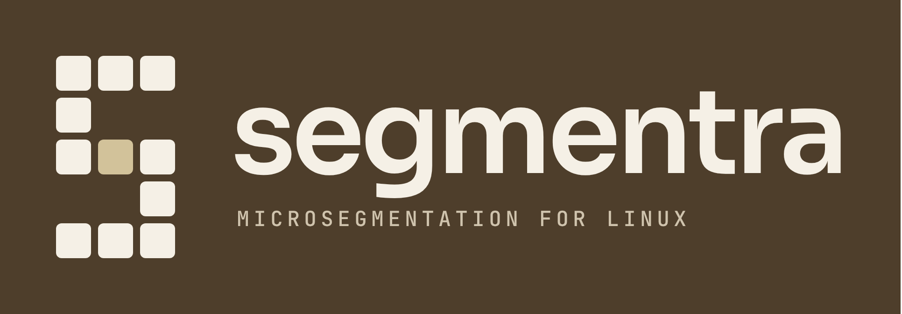
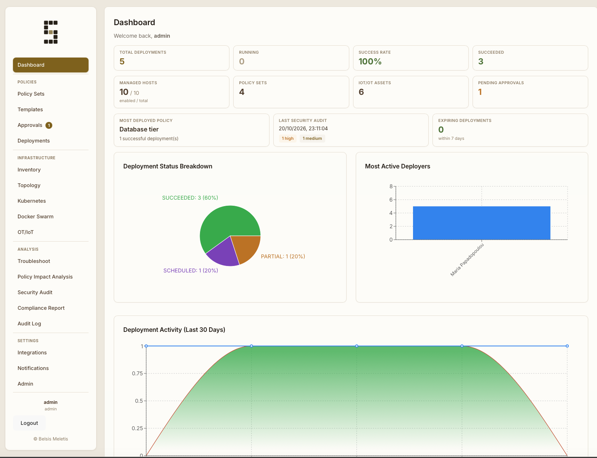
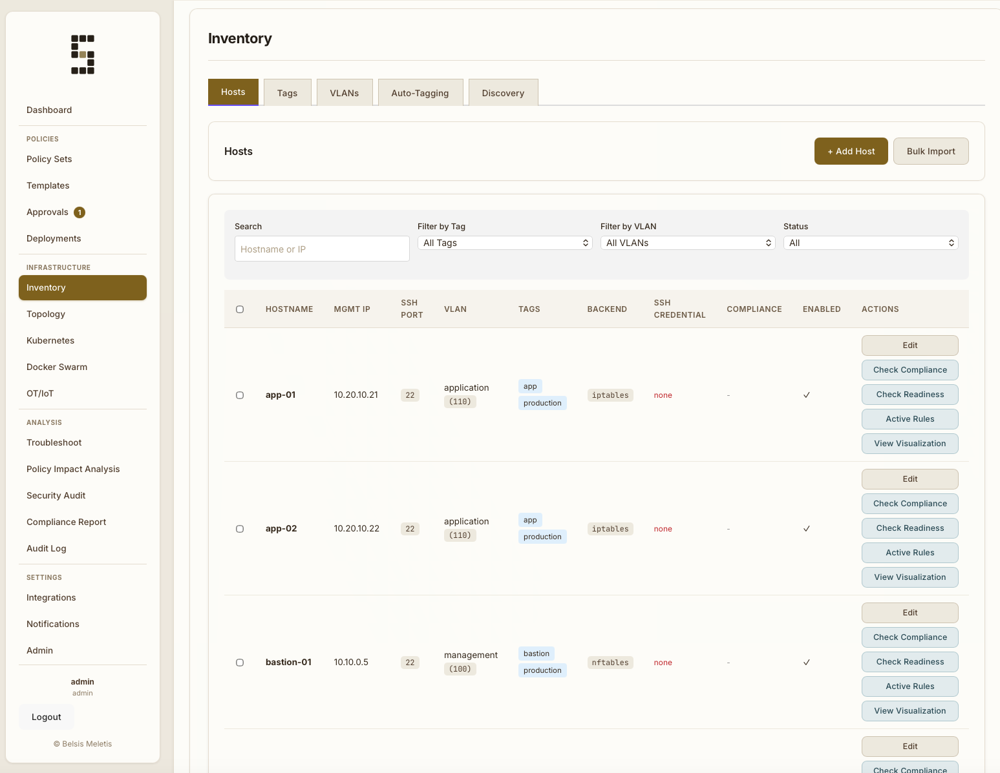

<div align="center">
  
</div>

# Segmentra

***Segmentra*** is an on-prem, web-based **fleet firewall & microsegmentation management** tool for Linux servers. It lets security and infrastructure teams centrally define **host firewall policies** (allow/deny), and deploy them at scale to nftables, iptables, firewalld, and UFW, via SSH or Ansible Playbook. It extends enforcement to **Kubernetes** clusters, **Docker Swarm** nodes and Docker-published ports, and **OT/IoT devices** through gateway firewalls.

The platform enables:
- **Inventory creation and auto-tagging**
- **Policy versioning**
- **Policy impact analysis**
- **Policy troubleshooting**
- **Policy canary testing**
- **Policy templates and auto-assignment**
- **Segregation of duties**
- **Approval tracking**
- **Audit trails**
- **Backup and restore** of the whole configuration, into a fresh installation if needed
- **Compliance monitoring**
- **Topology building**
- **OT/IoT protection** through gateway firewalls, with device discovery
- **Notifications** to Slack and webhooks on approvals, deployments and expiry
- **Default access rules for each policy**

**Future plans** include more integration adapters (SOAR, vulnerability databases), Kubernetes workload discovery from the cluster, and a real email notification channel. See [Testing status and future work](docs/testing-status.md#not-implemented-yet).

To go further, see [how it works](docs/how-it-works.md), the [features](docs/features.md) and the rest of the [documentation](#documentation).

---

## Screenshots

<table>
  <tr>
    <td align="center" width="50%">
      <a href="docs/screenshots/01-dashboard.png"></a><br>
      <b>Dashboard</b><br>
      <sub>Deployment statistics, managed hosts, IoT assets, pending approvals and the latest security audit</sub>
    </td>
    <td align="center" width="50%">
      <a href="docs/screenshots/05-inventory.png"></a><br>
      <b>Inventory</b><br>
      <sub>Hosts with tags, VLAN, backend, SSH credential, compliance, and the <b>Active Rules</b> action</sub>
    </td>
  </tr>
</table>

See [all the screenshots](docs/screenshots.md).

---

## Installation & Quick Start

### Development or production mode?

**Development mode runs the app directly on your machine so you can work on the code. Production mode runs everything in Docker with generated secrets.** It's the same application either way, but it's built, run and secured differently.

| | Development | Production |
|---|---|---|
| **Where it runs** | API and UI run on the machine with Node; only PostgreSQL is in Docker | Everything is in Docker: database, API, nginx web server and Ansible runner |
| **What you need** | Docker and Node.js 20+ | Docker only |
| **UI address** | `http://localhost:5173` (Vite dev server) | `http://localhost` on port 80 (nginx) |
| **API address** | `localhost:8080` | `127.0.0.1:8080`; browsers reach it through nginx at `/api` |
| **Admin login** | `admin` / `admin123` by default | Random password, printed once and saved in `.env` |
| **Secrets** | Generated JWT secret in `.dev-jwt-secret`; the encryption key is derived from it, unless you set one or `.env` has one | Random JWT secret and encryption key in `.env`; the API won't start without them |
| **Database password** | `segmentra`, or the one in `.env` if a production install wrote one | Random on a new install |
| **Migrations and seed** | Run by the install and run scripts | Run by the API container each time it starts |
| **`NODE_ENV`** | Not set to `production` | `production`, which turns on stricter checks such as refusing default JWT secrets |
| **Lifetime** | Stops with the terminal session; `./run.sh --start --development` (Windows: `.\run.ps1 --start --development`) rebuilds and starts it again | Containers run in the background until stopped |

**Which one to use:**

- **Development:** only if you're changing Segmentra's code.
- **Production:** for trying or actually using the app, even on a laptop.

"Production" doesn't mean hardened: the UI is plain HTTP and the API container mounts the Docker socket by default. Before exposing it, read [Security hardening](#security-hardening).

**On Windows, use `.\install.ps1 --production`.** In development mode, the code that deploys firewall rules runs directly on Windows. It needs tools like `sshpass`, which Windows doesn't normally have, so password-based SSH logins would probably fail. The Ansible runner container isn't started in development mode either. Production mode has `sshpass` in the API image and starts the runner. This comes from reading the code and hasn't been tested on Windows.

### Automated Installation

**Linux/macOS:**
```bash
./install.sh --development    # Local dev environment
./install.sh --production     # Docker production deployment
./install.sh --production --hardened   # Production with the hardened override (see Security hardening)
```

**Windows (PowerShell):**
```powershell
.\install.ps1 --development
.\install.ps1 --production
.\run.ps1 --start --development
```

`--hardened` is not available in `install.ps1` yet. The Windows scripts have not been run on real Windows yet, so please report anything that goes wrong.

**Prerequisites are checked first.** The installer lists everything that is missing for the chosen mode, then asks before changing anything:

- **Docker** is never installed for you, because it needs admin rights, may need a reboot, and Docker Desktop has licence terms. If it is installed but not running, the installer offers to start it. If Docker or the Compose plugin is missing, the installer says where to get it and stops without changing anything. If Docker can't be reached, you see Docker's own error message. On Windows the installer also finds Docker Desktop when `docker` isn't on `PATH`, waits if its engine is still starting, and stops if it is in Windows containers mode.
- **Node.js 20+** (development mode only) can be installed with Homebrew, apt, dnf/yum or winget. If your Linux distribution only offers an older version, the installer asks separately before adding the third-party NodeSource repository.
- **`ssh` and `sshpass`** (development mode only) are optional. The installer offers them on Linux and warns if they stay missing. Production mode includes them in the API image.

Add `--yes` to accept every offer, which scripted installs need because without a terminal the installer can't ask and declines. Add `--check` to only see the report; it changes nothing and exits with 1 if something required is missing.

If the API does not become healthy within 2 minutes, `--production` shows its last log lines and exits with an error instead of reporting success.

**Windows: if PowerShell says scripts are disabled or "not digitally signed"**, allow them for this window only and unblock the downloaded files, then run the installer again:

```powershell
Set-ExecutionPolicy -Scope Process -ExecutionPolicy Bypass
Get-ChildItem -Recurse -Include *.ps1 | Unblock-File
```

**Reinstalling and switching modes:** a database belongs to the `.env` that created it, and Docker Compose names the database after the folder, so a fresh copy in a folder with the same name finds the old database. `--production` then stops without changing anything, and development mode reports the password mismatch. Copy your earlier `.env` into the new folder to keep the data, or run `docker compose down -v` to delete it and start over.

Going from production to development in the same folder works once the production stack is stopped, because both use the same ports. A development install has no `.env`, so going the other way needs [a few extra steps](docs/installation.md#moving-from-development-to-production).

`--production` generates `JWT_SECRET`, `SEGMENTRA_KEK_B64`, `POSTGRES_PASSWORD` and `SEGMENTRA_ADMIN_PASSWORD` into `.env` (kept if already present) and prints the initial admin password. Back up `.env` — losing `SEGMENTRA_KEK_B64` makes stored SSH/LDAP secrets unrecoverable.

### Running

```bash
./run.sh --start --development    # Start dev (API + UI + DB)
./run.sh --stop --development     # Stop dev
./run.sh --start --production     # Start production (all Docker containers; the API runs migrations on start)
./run.sh --stop --production      # Stop production
```

On Windows use `.\run.ps1` with the same options. `--stop --development` only stops this folder's API and UI, not other projects' processes.

### Default Login

- **Development**: `admin` / `admin123` (created by the seed when `SEGMENTRA_ADMIN_PASSWORD` is not set — change it after first login)
- **Production** (`NODE_ENV=production`): `admin` / the value of `SEGMENTRA_ADMIN_PASSWORD` (min. 12 chars). Without it the seed refuses to create the default admin; use `SEGMENTRA_BOOTSTRAP_TOKEN` instead if you only use LDAP.

### Test labs (optional)

To try Segmentra on real firewalls without real servers, build a lab with one command. Each lab adds itself to the inventory, deploys a sample policy and checks real traffic against it. There are four: **base** (three hosts and a syslog collector), **IoT** (a gateway protecting simulated devices), **Swarm** (a real Docker Swarm) and **Kubernetes** (a real `kind` cluster).

With Segmentra running in development mode (`./start.sh dev`):

```bash
python3 scripts/demo-lab.py up --set-executor-ssh     # base lab; --lab iot or --lab swarm for the others, --lab k8s without the flag
python3 scripts/demo-lab.py down                      # remove it
```

They are for testing only: do not run them on a production Segmentra. What each lab builds, what to try and the full commands, including Windows, are in [docs/lab.md](docs/lab.md).

### Demo data (optional)

To see real firewalls and traffic instead, use the [test labs](#test-labs-optional). To explore the UI without real servers, load the sample dataset after the migrations and the seed. In the local development setup (`./run.sh --start --development`) the database runs on `127.0.0.1:15432` and the loader uses that connection when `DATABASE_URL` is not set:

```bash
npm run db:demo                 # local dev; set DATABASE_URL for another database
npm run db:demo -- --remove     # delete the demo data again
```

The dataset contains demo users with a well-known password, so the loader refuses to load it with `NODE_ENV=production`, into a database that is not on localhost (`DATABASE_URL` host other than `localhost` / `127.0.0.1` / `::1` / a Unix socket), or into a database that already has users or hosts not from the demo dataset, unless you pass `--force` (`npm run db:demo -- --force`; `SEGMENTRA_DEMO_FORCE=1` still works). In the Docker (production) install there is no Node.js on the host; load the file straight into the database container instead:

```bash
docker compose exec -T segmentra-db psql -U segmentra -d segmentra < packages/db/demo/demo-data.sql
docker compose exec -T segmentra-db psql -U segmentra -d segmentra < packages/db/demo/demo-remove.sql   # to remove it
```

It adds four VLANs, nine tags, ten Linux hosts (web, app, database, bastion, monitoring, SCADA and an OT gateway), four policy sets with versions in every lifecycle state (deployed, draft, pending approval, approved and scheduled), six OT/IoT devices protected by the gateway with FORWARD rules, deployments in several states and an audit trail. The file is `packages/db/demo/demo-data.sql` (plain SQL, idempotent: re-running changes nothing). Three demo users are created with the password `SegmentraDemo2026!`: `maria.p` (operator), `nikos.k` (approver) and `ana.v` (viewer). The demo hosts have no SSH credentials, so readiness, compliance and live-rule checks against them fail honestly; attach a credential and point a host at a real machine to go further.

### Docker

Production runs entirely in Docker; the images are built from this repository (no Node.js needed on the host):

```bash
./install.sh --production        # creates .env with generated secrets, builds and starts everything
# or manually, after creating .env:
docker compose up -d --build     # build the images and start db, API, web (nginx) and Ansible runner
```

Then open `http://<host>` (port 80). To upgrade: `git pull && docker compose up -d --build` (migrations run automatically). See [Building the Docker Images](docs/installation.md#building-the-docker-images) and [Upgrading](docs/installation.md#upgrading-to-a-new-version) for what each image contains, rebuilding single images and pushing to a registry.

### Security hardening

Segmentra can change the firewall of every managed host and stores SSH credentials with `sudo` rights on all of them, so a compromised Segmentra means compromised hosts. Before going to production:

- **Use the hardened override:** `./install.sh --production --hardened`, which records it in `.env` so later `docker compose` commands keep using it. By hand: `docker compose -f docker-compose.yml -f docker-compose.hardened.yml up -d --build`. This removes the Docker socket, makes the containers read-only, drops Linux capabilities, sets resource limits and publishes only nginx. It requires the SSH Direct executor.
- **Network:** serve the UI over TLS (reverse proxy) and make it reachable only from a management network or VPN.
- **Managed hosts:** use a dedicated SSH user with keys, restricted to logins from the Segmentra host, and set a management VLAN.
- **Secrets:** `chmod 600 .env` and back it up separately from database backups.
- **People:** use LDAP with MFA at your identity provider, keep few admins, and monitor the audit log (forward it to your SIEM).

The full guide, including what is already hardened and the remaining gaps, is in [docs/security.md](docs/security.md#hardening-a-production-install).

### Backup and restore

**Admin → Backup & Restore** exports the whole configuration (inventory, auto-tagging rules, OT/IoT assets, templates, every policy set with all versions and rules, settings) as one JSON file and restores it into any installation, including a fresh one; `./scripts/segmentra-backup.sh dump` takes a full database dump. What each one contains and how a restore behaves is in [docs/backup-restore.md](docs/backup-restore.md).

For detailed installation instructions, see [installation.md](docs/installation.md).

---

## Documentation

| Document | Description |
|----------|-------------|
| [How Segmentra Works](docs/how-it-works.md) | The whole flow and the user journey, from an empty installation to enforced rules |
| [Features](docs/features.md) | Everything Segmentra can do, by area |
| [Screenshots](docs/screenshots.md) | The main pages of the application |
| [Installation Guide](docs/installation.md) | Dev and production setup, environment variables and other configuration |
| [User Guide](docs/guide.md) | Step-by-step usage for all features |
| [Test Labs](docs/lab.md) | One-command environments with real firewalls and traffic: base, IoT, Swarm and Kubernetes |
| [Architecture](docs/Architecture.md) | Components, API endpoints, database schema, RBAC matrix |
| [Coexistence and Persistence](docs/coexistence-and-persistence.md) | Living alongside Docker, Kubernetes and fail2ban, and surviving reboots |
| [Native Firewall Managers](docs/firewall-managers.md) | Firewalld/UFW support, permanent ACLs, prerequisites, limitations, and verification |
| [Backup and Restore](docs/backup-restore.md) | Configuration export/import (Admin page, API) and full database dumps |
| [Security: Credentials, Secrets and Hardening](docs/security.md) | How credentials are encrypted, the encryption key, who can access them, and how to harden a production install |
| [OT/IoT Guide](docs/iot.md) | IoT microsegmentation with gateway model |
| [Gateway Setup](docs/gateway-setup-guide.md) | Linux gateway firewall configuration |
| [Kubernetes Guide](docs/kubernetes.md) | K8s NetworkPolicy management |
| [Docker Swarm Guide](docs/docker-swarm.md) | Swarm node profile and Docker-published ports |
| [Policy as Code](docs/policy-as-code.md) | YAML/JSON export and import, CLI and CI workflow |
| [Compliance Reports](docs/compliance-reports.md) | Evidence reports mapped to PCI DSS, ISO 27001, SOC 2 and HIPAA |
| [Status and Limitations](docs/testing-status.md) | Known limitations, what has been tested, what has not, and what is not implemented yet |
| [Tests](tests/README.md) | Integration and unit tests, what they cover and how to run them |
| [Ansible Playbook](docs/playbook-ansible.md) | Deployment playbook documentation |
| [Original Specification](docs/segmentra_fleet_microsegmentation_firewall_manager_full_specification.md) | The original product specification (historical; the implementation differs in places) |

---

## License

Segmentra is licensed under the [Apache License 2.0](LICENSE). Copyright 2026 Belsis Meletis (see [NOTICE](NOTICE)). To report a vulnerability, see [SECURITY.md](SECURITY.md).

### Disclaimer: provided "as is", no liability

**Segmentra is provided "AS IS", without warranty of any kind**, express or implied, including merchantability, fitness for a particular purpose, security, reliability and non-infringement.

**The creator and contributors accept no liability, to the maximum extent permitted by law,** for any damage, loss or claim of any kind arising from the use of, or inability to use, this software, whether in contract, tort or otherwise. This includes, without limitation:

- data loss or corruption;
- downtime, outages or loss of access to systems (including being locked out of hosts);
- security incidents, breaches or vulnerabilities, in Segmentra or in the systems it manages;
- misconfigured, missing or ineffective firewall rules, and traffic that is blocked or allowed by mistake;
- financial, business, legal or regulatory loss, including failed audits (compliance reports are supporting evidence, not an audit opinion or a certification).

Segmentra changes firewall rules on real hosts, clusters and gateways, and is a **work in progress** that has been tested mainly in lab environments (see [Testing status](docs/testing-status.md)). **You use it entirely at your own risk and responsibility.** Test it on non-critical systems first, keep out-of-band access, keep backups, and review every policy before deploying it.

Nothing in this README, the documentation or the user interface changes the terms of the [LICENSE](LICENSE), sections 7 (Disclaimer of Warranty) and 8 (Limitation of Liability).
