<div align="center">
  
</div>

# Segmentra

***Segmentra*** is an on-prem, web-based **fleet firewall & microsegmentation management** tool for Linux servers. It lets security and infrastructure teams centrally define **host firewall policies** (allow/deny), and deploy them at scale to nftables, iptables, firewalld, and UFW, via SSH or Ansible Playbook. It extends enforcement to **Kubernetes** clusters, **Docker Swarm** nodes and Docker-published ports, and **OT/IoT devices** through gateway firewalls.

The platform enables:
- **Inventory creation and auto-tagging**
- **Policy versioning**
- **Policy impact analysis**
- **Policy troubleshooting**
- **Policy canary testing**
- **Policy templates and auto-assignment**
- **Segregation of duties**
- **Approval tracking**
- **Audit trails**
- **Compliance monitoring**
- **Topology building**
- **OT/IoT protection** through gateway firewalls, with device discovery
- **Notifications** to Slack and webhooks on approvals, deployments and expiry
- **Default access rules for each policy**

**Future plans** include more integration adapters (SOAR, vulnerability databases), Kubernetes workload discovery from the cluster, and a real email notification channel. See [Future Work](#future-work).

---

## How it works: the whole flow

Segmentra never changes a firewall on its own. Every change goes through the same path, and **nothing is deployed automatically after an approval**: a person has to create and start the deployment (or schedule it).

```
1 Build the inventory  ->  2 Policy set + scope  ->  3 Version + rules  ->  4 Approval  ->  5 Deployment  ->  6 Verify & operate
```

**1. Build your inventory** (*Inventory*, *OT/IoT*, *Kubernetes*)
- **Linux servers:** add hosts by hand, **Bulk Import** a CSV, or let **Discovery** scan your networks for SSH and import what it finds. Group them with **tags** (also automatic, with **Auto-Tagging** rules) and **VLANs**. **Check Readiness** confirms Segmentra can log in, use sudo and find the firewall tool.
- **OT/IoT devices:** pick a Linux host that sits in front of the devices, tag it `iot-gateway`, then open **OT/IoT**: register the devices by hand, or use the **Discovery** tab to list what the gateway sees (its ARP table, optionally an active ping probe of a subnet) and import the devices. Assign each device to its gateway. The devices themselves are never touched; the gateway firewall protects them. See [docs/iot.md](docs/iot.md).
- **Docker Swarm:** give every node of the swarm the same **Swarm name** in the Docker section of its host form; the **Docker Swarm** page (with a how-to) shows the nodes and warns about gaps. See [docs/docker-swarm.md](docs/docker-swarm.md).
- **Kubernetes:** register each cluster under **Kubernetes** with its CNI and credentials, and optionally map workloads (pod labels) to tags. See [docs/kubernetes.md](docs/kubernetes.md).

**2. Create a policy set and choose its scope** (*Policy Sets*)
A policy set decides **where** its rules apply: all hosts with certain **tags**, hosts in a **VLAN**, or a **specific list of hosts**. You can start from scratch, from a **Template** (a reusable rule set such as "Web Server"; a template with auto-apply creates a DRAFT policy when its tag is first assigned), from the **Topology** page (draw flows between groups and generate a draft policy from them), from recommendations after **Firewall Learning**, or from a YAML file ([Policy as Code](#policy-as-code)). All of these only ever produce a `DRAFT`.

**3. Add rules to a version** (*Policy Sets → New Version*)
Each change is a new version. Add allow/deny rules (direction, protocol, ports, source; on gateways also FORWARD rules with a destination or IoT device). Before asking for approval you can check the effect with **Policy Impact Analysis**, **Troubleshoot** (would this traffic be allowed?) and the **Security Audit** for risky rules.

**4. Request approval** (*Submit for Approval*, then *Approvals*)
The author submits the version with an optional reason; it becomes `PENDING_APPROVAL` and read-only. A second person with the `approver` or `admin` role (never the author) reviews the rules and either approves or rejects with a reason. A rejected version is fixed and resubmitted; the author sees the outcome on the Dashboard and next to the policy set. Everything is written to the audit log, and the **notification channels** (Slack or webhook) can alert reviewers and authors.

**5. Deploy it: a separate, manual step** (*Deployments*)
After approval the version is only `APPROVED`; no rule is on any host yet. An operator or admin then:
1. opens **Deployments → + Create Deployment** and selects the approved version, the target hosts and a mode (**Full**, **Canary** to try a few hosts first, or **Progressive** in batches);
2. optionally **schedules** it for a maintenance window (it then starts by itself at that time) and sets an **expiry** (notify only, remove the rules, or revert to the previous version);
3. clicks **Start** (high-risk deployments first need a second person's deployment approval).

Segmentra backs up each host, applies the rules over SSH or Ansible, checks it can still reach the host (and rolls back if not), and records the result per host. The version then becomes `DEPLOYED`. For **IoT gateways** this is the same flow: their policy set is deployed to the gateway. For **Kubernetes**, open the approved version and **Generate NetworkPolicy**, then **Apply** it to a cluster (also a manual step); Segmentra can check and remove what it applied.

**6. Verify and operate**
**Check Compliance** finds rules changed by hand on a host (drift), **View Visualization** shows what a host allows, **Firewall Learning** and **Policy Impact Analysis** observe real traffic, and the **Audit Log**, **Compliance Report**, **Notifications** and **Integrations** (SIEM) give you the trail and the alerts. Details of every step, with roles, are in the [User Journey](#user-journey).

---

## Screenshots

Click an image to open it full size.

<table>
  <tr>
    <td align="center" width="33%">
      <a href="screehsots/01-dashboard.png">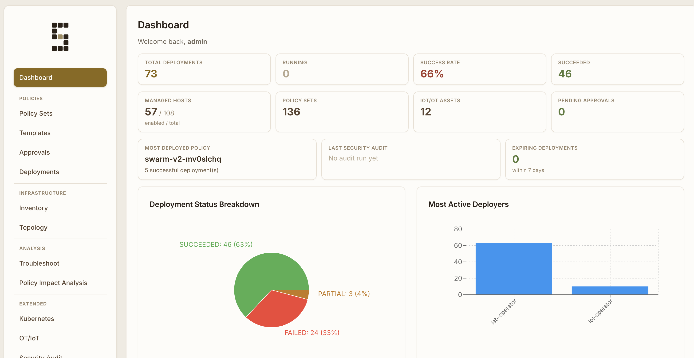</a><br>
      <b>Dashboard</b><br>
      <sub>Deployment statistics, managed hosts, pending approvals and the latest security audit</sub>
    </td>
    <td align="center" width="33%">
      <a href="screehsots/02-policy-sets.png">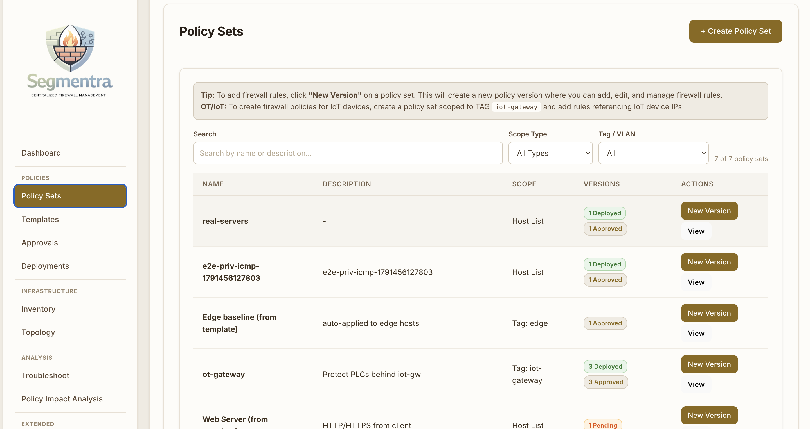</a><br>
      <b>Policy Sets</b><br>
      <sub>Policies with their scope (tag, VLAN or host list) and version status</sub>
    </td>
    <td align="center" width="33%">
      <a href="screehsots/03-policy-templates.png">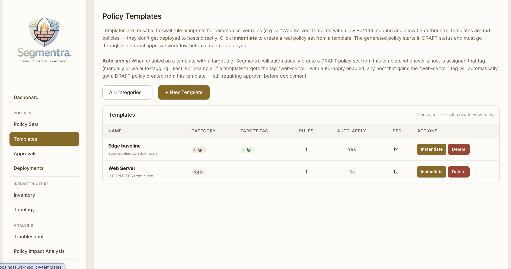</a><br>
      <b>Policy Templates</b><br>
      <sub>Reusable rule sets, optionally auto-applied when a host gets a tag</sub>
    </td>
  </tr>
  <tr>
    <td align="center" width="33%">
      <a href="screehsots/04-inventory.png">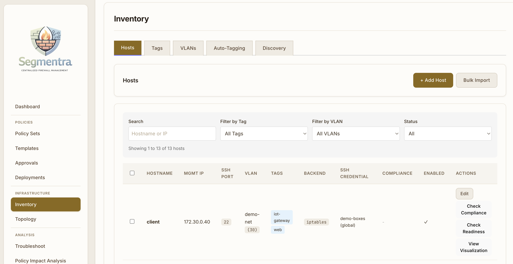</a><br>
      <b>Inventory</b><br>
      <sub>Hosts with tags, VLAN, firewall backend, effective SSH credential and compliance</sub>
    </td>
    <td align="center" width="33%">
      <a href="screehsots/05-topology.png">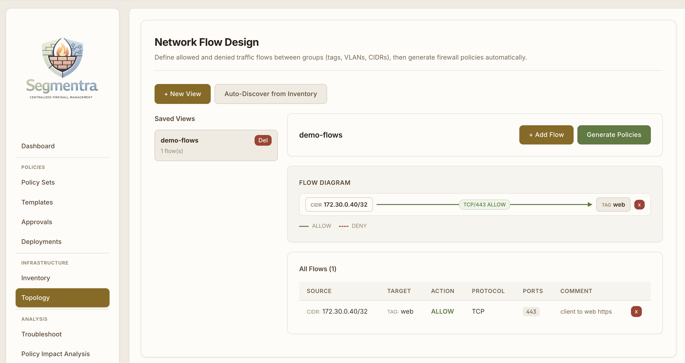</a><br>
      <b>Topology</b><br>
      <sub>Draw allowed and denied flows between groups and generate policies from them</sub>
    </td>
    <td align="center" width="33%">
      <a href="screehsots/06-troubleshoot.png">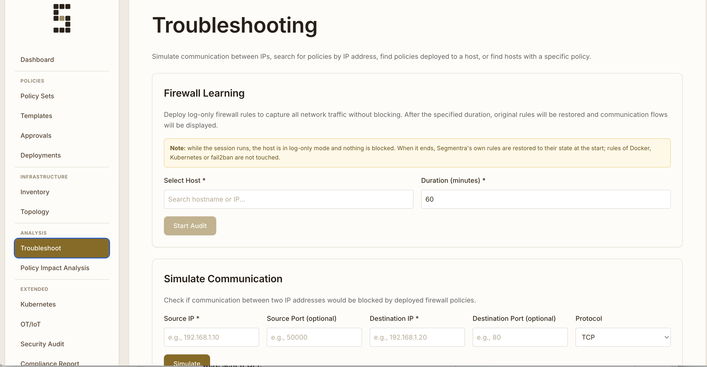</a><br>
      <b>Troubleshoot</b><br>
      <sub>Firewall Learning (log-only traffic discovery) and the communication simulator</sub>
    </td>
  </tr>
  <tr>
    <td align="center" width="33%">
      <a href="screehsots/07-policy-impact-analysis.png">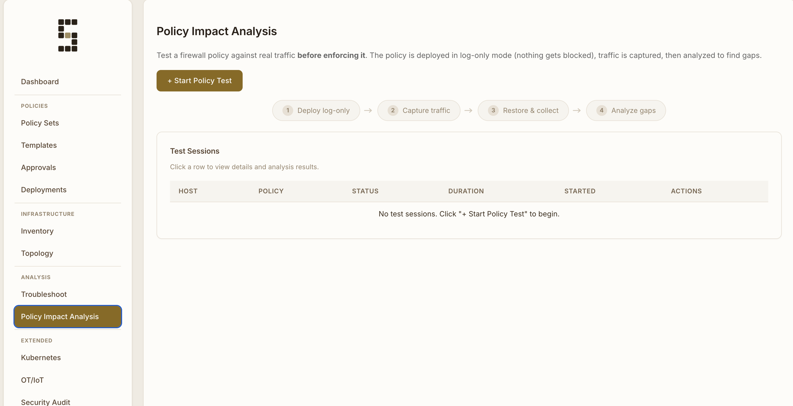</a><br>
      <b>Policy Impact Analysis</b><br>
      <sub>Test a policy against real traffic in log-only mode before enforcing it</sub>
    </td>
    <td align="center" width="33%">
      <a href="screehsots/08-security-audit.png">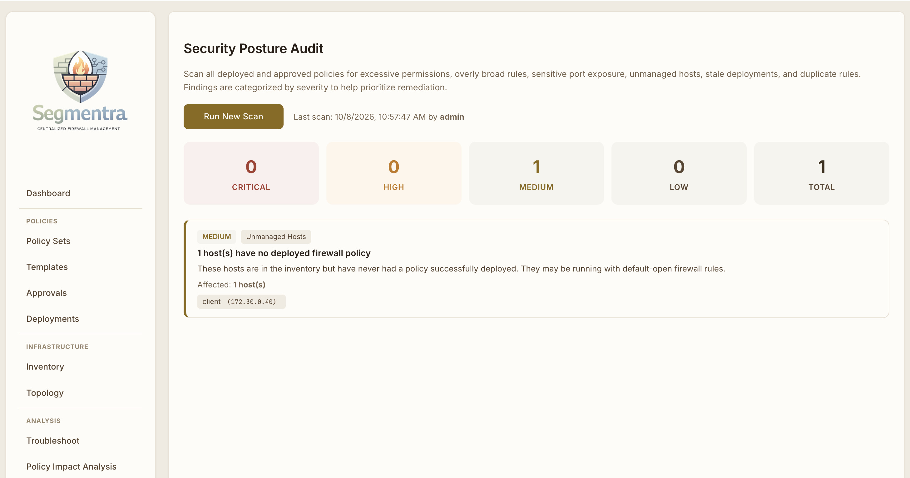</a><br>
      <b>Security Audit</b><br>
      <sub>Findings by severity, e.g. hosts without a deployed policy</sub>
    </td>
    <td align="center" width="33%">
      <a href="screehsots/09-audit-log.png">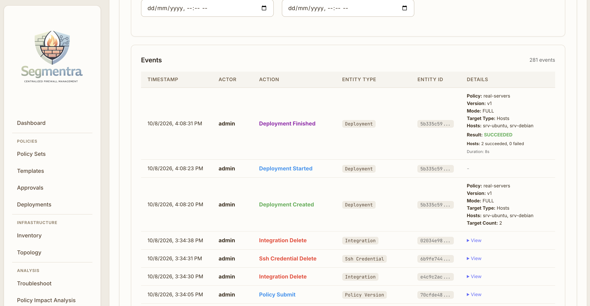</a><br>
      <b>Audit Log</b><br>
      <sub>Every change and deployment, with actor and details</sub>
    </td>
  </tr>
  <tr>
    <td align="center" width="33%">
      <a href="screehsots/10-policy-rules.png">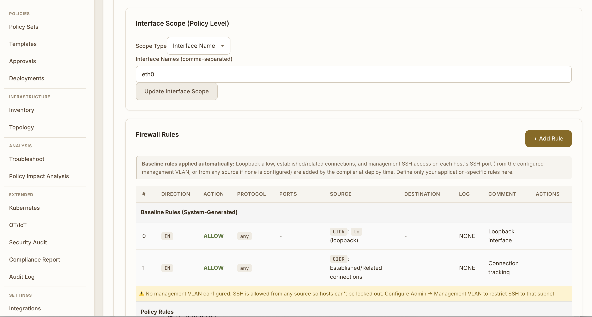</a><br>
      <b>Policy Rules</b><br>
      <sub>Interface scope, the automatic baseline rules and the rules of a policy version</sub>
    </td>
    <td align="center" width="33%">
      <a href="screehsots/11-inventory-discovery.png">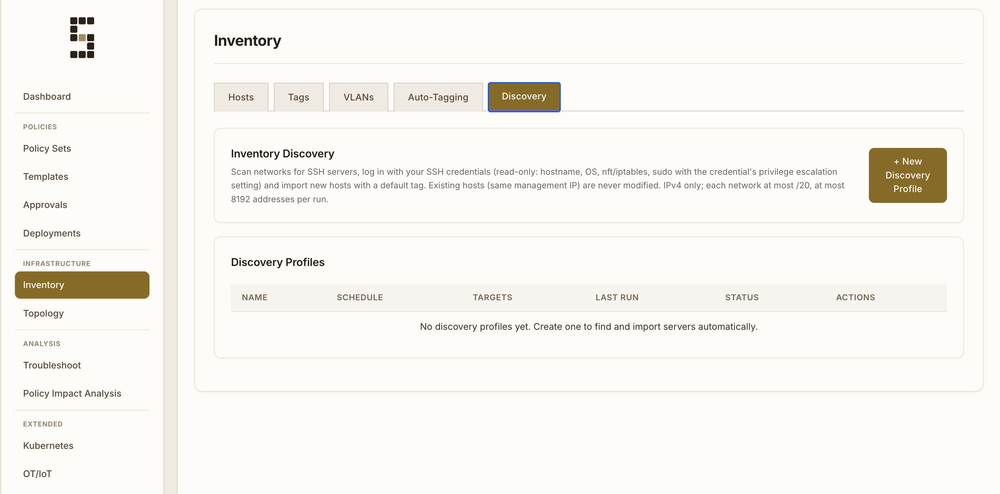</a><br>
      <b>Inventory Discovery</b><br>
      <sub>Scan networks for SSH servers and import them as hosts</sub>
    </td>
    <td align="center" width="33%">
      <a href="screehsots/12-compliance-report.png">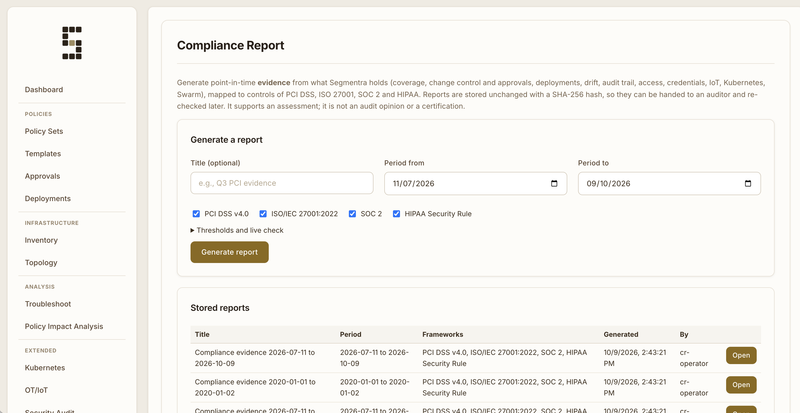</a><br>
      <b>Compliance Report</b><br>
      <sub>Point-in-time evidence for PCI DSS, ISO 27001, SOC 2 and HIPAA, stored with a SHA-256</sub>
    </td>
  </tr>
  <tr>
    <td align="center" width="33%">
      <a href="screehsots/13-admin.png">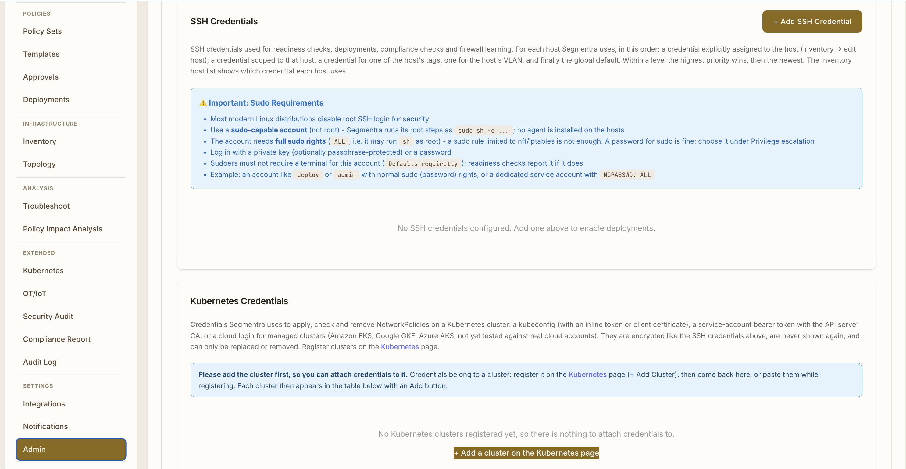</a><br>
      <b>Admin</b><br>
      <sub>SSH and Kubernetes credentials, users and roles</sub>
    </td>
  </tr>
</table>

---

## Features & Capabilities

### Authentication & Authorization
- **LDAP/Active Directory Integration** with AD group-to-role mapping (group DNs are matched case- and whitespace-insensitively; LDAP users' passwords can't be reset in Segmentra)
- **Local User Management** — create, edit, disable, and reset passwords for local users directly in the Admin UI (no LDAP required for small teams)
- **Role-Based Access Control (RBAC)** enforced at both API and UI level:
  - **Viewer** — read-only access to all dashboards, inventory, policies, and deployments
  - **Operator** — manage inventory, create policies/rules, run deployments, troubleshoot, manage IoT assets
  - **Approver** — approve/reject policy versions (separation of duties — cannot create policies)
  - **Admin** — full access including users, LDAP, SSH credentials, integrations, notifications, and system settings
- **JWT Authentication** — stateless tokens in browser localStorage, sent as `Authorization: Bearer <token>`
- **Separation of Duties** — a policy version cannot be approved by the user who created, edited or submitted it; high-risk policies require a different approver even for admins

### Inventory Management
- **Host Management** — add Linux servers with management IPs, SSH ports, firewall backend selection (nftables/iptables/firewalld/ufw/auto)
- **Tags & VLANs** — organize hosts by custom tags and VLAN membership; VLANs also serve as OT/IoT zones. A tag or VLAN that policy or template rules still reference can't be deleted
- **Auto-Tagging Rule Engine** — define criteria (hostname regex, CIDR ranges, OS family, VLAN, existing tags) with AND/OR logic to automatically classify hosts; evaluates every 5 minutes and on-demand
- **Automated Discovery** — discovery profiles scan IPv4 networks (CIDRs and/or VLAN subnets, max /20 per network and 8192 addresses per run) for SSH, log in with existing or new SSH credentials (read-only fact collection: hostname, OS, nft/iptables, sudo) and import new hosts with a default tag (`new-server`); manual **Run Now** or on a schedule, with per-address run history
- **System Tags** — `iot-gateway` and `bastion` are protected tags that cannot be deleted
- **Interface Configuration** — define network interfaces with roles (data, management, backup, etc.)
- **Bulk Operations** — CSV import, bulk tag/VLAN assignment, bulk enable/disable
- **Host Readiness Check** — detect active firewall managers and verify firewall tools, sudo access, and reboot persistence before deployment
- **Native Firewall Managers** — persistent firewalld policy objects and UFW custom-rule blocks, loaded by the native boot service without a Segmentra agent. Persistence failure fails native-manager deployment. See [requirements and limits](docs/firewall-managers.md).

Supported Linux backends are **nftables, iptables, firewalld, and UFW**. Select one in Inventory or use `auto`, which prefers an active native manager. Firewalld/UFW support enforced ACL deployment, removal, rollback, IPv4/IPv6, and drift/compliance. Native learning/log-only sessions are not yet supported.
- **Compliance & Drift Detection** (agentless) — SSH-based comparison of current firewall rules vs. last deployed policy hash
- **Policy Visualization** — interactive SVG diagrams showing connections per host (color-coded allow/deny)

<div align="center">
  
</div>

### Policy Management
- **Policy Sets** — organize rules by scope (TAG, VLAN, or HOST_LIST)
- **Version Control** — every change creates a new version with the lifecycle DRAFT → PENDING_APPROVAL → APPROVED / REJECTED → DEPLOYED; approved, deployed and pending versions can be ARCHIVED
- **Policy Templates** — reusable blueprints (e.g., "Web Server") with one-click instantiation; optional auto-apply creates a DRAFT policy when a matching tag is first assigned to hosts
- **Visual Topology Design** — draw network flows between groups, auto-discover from existing infrastructure, and generate policies automatically
- **Policy Recommendations** — after firewall learning, auto-generate rules from observed traffic with confidence scoring and IP-to-tag resolution
- **Policy as Code** — policy sets as YAML/JSON documents (tags, VLANs, hosts by name) that can be exported, reviewed in Git and imported again; imports only ever create DRAFT versions. See [Policy as Code](#policy-as-code) below
- **Policy Impact Analysis** — semantic diff showing new/removed allows and denies per host before approval
- **High-Risk Detection** — audit policies to flag broad rules, wide scopes, and sensitive port exposure
- **Policy Expiry** — optional time-limited deployments with 24-hour warnings. On expiry the deployment is marked `EXPIRED`, a notification is sent and the expiry action runs: `NOTIFY_ONLY` does nothing else, `REMOVE` removes Segmentra's rules (`table inet segmentra` or the `SEGMENTRA-*` chains) from the hosts, and `REVERT` redeploys the previous successfully deployed version of the same policy set
- **Policy Archive & Delete** — archive deployed/approved versions (read-only), delete DRAFT/REJECTED versions

### Deployment Management
- **Deployment Modes** — Full, Canary, and Progressive. With the SSH Direct executor hosts are deployed one at a time in hostname order: Canary stops if one of the first *N* canary hosts (default 1) fails, Progressive stops at the end of a batch (default 5 hosts) that had a failure; halted hosts are marked skipped and can be resumed with **Retry Failed Hosts**. The Ansible executor deploys all target hosts in one playbook run
- **Scheduled Deployments** — schedule for future execution (e.g., maintenance windows); auto-starts via background job
- **Two Executors** — Ansible (parallel, recommended) or SSH Direct (lightweight, no Ansible dependency)
- **Safety Guardrails** — pre-deployment validation ensures SSH access from management VLAN is preserved
- **Automatic Rollback** — failed deployments restore previous state from host-local backups
- **Real-time Tracking** — per-host deployment status with 10-minute timeout for unresponsive hosts; **Retry Failed Hosts**, pause/resume/stop, and a deployment-level approval for high-risk deployments
- **Lockout protection** — after applying rules Segmentra checks that it can still reach the host over SSH; if not, the previous rules are restored automatically after 120 seconds

<div align="center">
  
</div>

### Troubleshooting & Analysis
- **Communication Simulation** — test if traffic between two IPs would be blocked by deployed policies
- **Firewall Learning** (agentless) — deploy log-only rules via SSH, capture all traffic for a set duration, auto-restore original rules, parse and display communication flows
- **On-Device Policy Testing** — deploy a specific policy in log-only mode, then analyze observed traffic for coverage gaps (matched, unmatched, unexpected blocks)
- **Policy Search** — find which policies apply to a specific IP, host, or policy version

<div align="center">
  
</div>

### OT/IoT Microsegmentation
- **Separate Asset Inventory** — register PLCs, HMIs, sensors, cameras, HVAC, medical devices with vendor/model/firmware/criticality metadata
- **Gateway Model** — IoT devices are assigned to gateway firewalls (regular Linux hosts tagged `iot-gateway` in the inventory); policies deploy to gateways via the normal SSH/Ansible pipeline
- **VLANs as Zones** — OT network zones (Purdue levels) are defined as VLANs in the inventory
- **Traffic Discovery** — run Firewall Learning on the gateway host to observe IoT traffic passively
- **Deployment Warning** — deploying to IoT gateways triggers a warning about impact on protected devices
- **Protocol Catalog** — about 35 OT/IoT services (Modbus/TCP, DNP3, EtherNet/IP, S7, OPC UA, BACnet, MQTT, ...) with default ports and a cleartext/encrypted flag; pick one in the rule form or write `service: modbus-tcp` in a policy document. Port matching only, no deep inspection
- **Protection Coverage** — shows which assets are protected, by which gateway and which services are allowed to reach them (zones, cleartext warnings); it is derived from recorded deployments, not a live check
- **Discovery** — lists devices from a gateway's ARP/NDP table over SSH (passive: nothing is sent to the devices) and, as an explicit opt-in with a warning, probes a subnet of up to a /24 from the gateway with one ICMP echo per address to find quiet devices, with vendors from an IEEE OUI list you import, and imports them as assets
- **Compliance integration** — IoT coverage appears in the compliance reports

**Not tested yet:** the full IEEE OUI file, real PLCs and cameras, IPv6-only neighbours. **Not supported yet:** deep protocol inspection, flow ingestion, port scanning or fingerprinting of devices. The active probe was only tested on a Docker bridge. See the [OT/IoT guide](docs/iot.md#8-industrial-protocols-coverage-and-discovery).

### Kubernetes Microsegmentation

Segmentra turns approved policy versions into Kubernetes **NetworkPolicy** manifests and can apply, check and remove them on your clusters. See the [Kubernetes Guide](docs/kubernetes.md).

**Capabilities**
- **Cluster registry** — register several clusters, each with its CNI plugin (kindnet, Calico, Cilium, Antrea, Weave, kube-router, other) and default namespace.
- **Stored credentials** — a kubeconfig with an inline token or client certificate, a service-account/bearer token plus the API server CA, or a **cloud login** for managed clusters (see below). They are encrypted like the SSH and LDAP secrets, never shown again, and managed per cluster or in **Admin → Kubernetes Credentials**. **Test connection** checks them. API server addresses in the link-local/cloud-metadata range are refused.
- **Cloud logins (implemented, not yet tested against real clouds)** — **Amazon EKS** (AWS access key, secret key and optional session token; Segmentra mints the same token as `aws eks get-token`), **Google GKE** (service-account JSON key, exchanged for an access token) and **Azure AKS** (Entra ID service principal). Nothing is executed: no AWS CLI, `gke-gcloud-auth-plugin` or `kubelogin` is needed, and kubeconfigs that rely on those exec plugins are still rejected. You also supply the cluster's API endpoint and CA certificate. See [Not tested yet](#kubernetes-not-tested-yet).
- **NetworkPolicy generation** — **Generate NetworkPolicy** translates the inbound ALLOW rules of an approved or deployed policy version into an Ingress-only `networking.k8s.io/v1` manifest. Sources become `ipBlock` peers (CIDR, HOST, VLAN and the hosts of a TAG; multiple CIDRs and `any` are supported). Rules NetworkPolicy cannot express (DENY, FORWARD, ICMP, outbound) are skipped with a warning, and a source that resolves to nothing is never widened to `0.0.0.0/0`.
- **Label-based sources** — register workloads with their pod labels and map them to Segmentra tags. A rule whose source is such a tag allows those pods by `namespaceSelector` + `podSelector`, which works on every CNI. A TAG can mix host IPs and labelled workloads.
- **Apply, Dry run, Check and Remove from Segmentra** — server-side apply creates or updates the policy; **Dry run** validates it first; **Check** compares the live policy with Segmentra's manifest (in sync, drifted, missing); **Remove** deletes it. Status, last error and drift state are tracked per manifest, and every action is audited.
- **Safety guards** — Segmentra only touches policies carrying the `app.kubernetes.io/managed-by: segmentra` label and refuses to overwrite or delete a same-named policy it did not create. It refuses to apply an older manifest over a newer one, and apply asks for confirmation showing the generation warnings.
- **Manual route** — you can still copy the `kubectl apply` command or download the JSON and apply it with your own pipeline.

**Limitations**
- **Cilium ignores `ipBlock` for in-cluster traffic.** IP-based sources only match clients outside the cluster there, so a policy built only from CIDR/HOST/VLAN sources blocks all in-cluster clients. Segmentra warns when the cluster CNI is Cilium or unknown; use tags mapped to labelled workloads for in-cluster clients. Calico and kindnet match `ipBlock` for pods.
- **Ingress only, allow-only.** DENY rules cannot be expressed in a NetworkPolicy, and ICMP and FORWARD rules are skipped.
- **A policy denies everything else inbound.** Once applied, only traffic allowed by the policy reaches the pods in that namespace. Review the warnings and use Dry run first.
- **Enforcement depends on the CNI.** A cluster without a NetworkPolicy-capable CNI (for example plain kubenet) accepts the policy but does not enforce it.
- **Credential limits.** A kubeconfig must carry inline credentials: file paths, exec plugins, auth providers and proxies are rejected (use a cloud login or a token instead). Static tokens expire and must be replaced before then; cloud logins mint a fresh short-lived token on every call. The API server must be reachable from the Segmentra API (inside the container in the Docker deployment) over HTTPS.
- **Not tracked:** policies applied outside Segmentra stay `Generated`; deleting a cluster record does not remove policies already on the cluster.
- **Tested only on kind**, plus unit tests for the cloud token minting; see below.

<a id="kubernetes-not-tested-yet"></a>
**Not tested yet** (the code or documentation exists, but it has not been verified)
- **Amazon EKS, Google GKE and Azure AKS clusters.** The cloud logins are implemented and checked offline: the SigV4 signing reproduces AWS's published example signature, the GKE JWT signature is verified with the public key, the AKS request is checked against a mock token endpoint, and the whole path was exercised against a kind API server (the token is minted and sent, and the 401 is reported). They have **never been run against a real AWS, Google or Azure account**. On those services the network-policy feature must also be switched on (AWS VPC CNI network policy agent, GKE Dataplane V2 or Calico, AKS network policy).
- **OpenShift and Rancher.**
- **Antrea, Weave Net and kube-router** CNIs (only kindnet, Calico and Cilium were tested).
- **IPv6-only and dual-stack clusters.**
- **Windows nodes.**

**Not supported yet**
- **Egress rules.** Egress is never restricted.
- **Vendor policy types:** `CiliumNetworkPolicy`, Calico `GlobalNetworkPolicy` and `AdminNetworkPolicy`.
- **Selecting a subset of pods.** Each policy covers the whole namespace (`podSelector: {}`).
- **Discovering workloads from the cluster.** The sync endpoint returns `501`; workloads are registered by hand with their labels.
- **Other exec-plugin / OIDC logins** (kubeconfigs that run a program or read a token file) and API servers reachable only through a proxy or over plain `http`.

### Policy as Code

Policy sets can be written, reviewed and applied as **YAML or JSON documents** instead of being typed into the web form. The document uses names for tags, VLANs, hosts and IoT assets, so it can live in Git and be applied to another Segmentra instance. See the [Policy as Code Guide](docs/policy-as-code.md).

**How it works**
1. **Export** a policy set (or one version) from the UI (**Export YAML / JSON** on each version), the API or `scripts/segmentra-policy.mjs export`. The output is deterministic, so repeated exports do not create noise in Git.
2. **Edit** the document and keep it in a repository. The policy set is identified by `metadata.name`.
3. **Plan.** **Import YAML/JSON** with **Check (dry run)**, `segmentra-policy plan` or `?dryRun=true` validate the document and show exactly what would change: rules added (`+`), removed (`-`) or reordered, and warnings. It writes nothing. `plan --detailed-exitcode` exits 2 when changes are pending, for CI.
4. **Apply.** **Import as DRAFT**, `segmentra-policy apply` or the API creates the policy set, or adds a new **DRAFT** version.
5. **Review and deploy as usual.** The draft is submitted for approval, approved by a **different** person (the importing user is recorded as an editor and cannot approve it) and deployed. High-risk detection runs on it like on any version.

**Capabilities**
- **Never approves or deploys.** An import cannot get a rule onto a host by itself; the approval and deployment workflow is unchanged.
- **Idempotent.** Applying the same document again changes nothing, also before the draft is approved, so `apply` can run on every push.
- **Strict validation with every problem at once.** Unknown keys are errors (a typo such as `port:` is reported, not ignored), each rule is validated on its own with the rule editor's checks, and each problem is shown with its path, for example `spec.rules[2].source`.
- **Scope protection.** A different scope in the document (which hosts a deployment targets) is only reported as a warning unless `updateScope` is given.
- **Roles.** Viewers can export; only operators and admins can import. Every import is written to the audit log (`POLICY_IMPORT`).
- **Git and CI.** The CLI has `export`, `plan` and `apply`, handles directories and multi-document YAML files, and the docs include a GitHub Actions example (`plan` on pull requests, `apply` on merge).

**Limitations**
- Segmentra does not pull from Git by itself; a CI job pushes.
- A document refers to existing tags, VLANs, hosts and IoT assets; it never creates them, and it cannot delete or rename a policy set (the name is the identity). Two policy sets with the same name make an import refuse.
- Rules in the document replace the rules of the new version; they are not merged with the previous ones.
- No published JSON Schema, and no atomic import of several policy sets (the CLI applies documents one by one).

**Tested:** `npm run test:integration:policy-code` (48 checks through the API and CLI) and a manual run in Chrome (file picker, dry run, import, export, approval, separation of duties). **Not tested yet:** the browser's own file-download step (the content was verified), the CLI on Windows, the CI example on a real runner, and very large or concurrent imports.

### Compliance Evidence Reports

Generate a **point-in-time evidence report** for an assessor, mapped to controls of **PCI DSS v4.0, ISO/IEC 27001:2022, SOC 2 and the HIPAA Security Rule**. It is evidence from the data Segmentra holds, not an audit opinion or a certification. See the [Compliance Reports Guide](docs/compliance-reports.md).

**How it works.** Compliance Report in the sidebar (or `POST /api/compliance/reports`): choose the frameworks and a period (default 90 days). Segmentra collects the evidence from its own data without touching any host, turns it into measurements, evaluates every control (**Evidence**, **Attention**, or **Not covered** with the reason), stores the snapshot with its **SHA-256**, and records the generation in the audit log. The report is read as a JSON document, a stand-alone printable HTML page (Save as PDF from the browser), or CSV datasets (controls, hosts, changes, deployment failures, inactive users, SSH credentials, IoT assets, and the full audit events of the period). Every read recomputes the hash and shows whether the stored report is intact.

**What it covers**
- **Coverage:** enabled hosts under a deployed policy, hosts without one, stale hosts, policy sets not approved recently.
- **Change control:** versions approved in the period, approval time, high-risk approvals, approvals by someone who edited or submitted the version (Segmentra refuses these, so it should be zero), approvals waiting too long.
- **Deployments:** outcomes, failed hosts, automatic rollbacks. **Drift:** optional live check that reads the managed hosts over SSH.
- **Access and credentials:** accounts and roles, administrators, accounts without a recent login, SSH credentials not rotated, Kubernetes clusters with TLS verification disabled.
- **Audit trail:** events in the period by action, administrative and credential events.
- **IoT/OT, Kubernetes and Docker Swarm:** assets without a protecting gateway, policy status and drift, Swarm nodes.

**Limitations.** A snapshot, not a history (generate regularly to show a trend; there is no scheduler). Segmentra only sees its own inventory. The hash detects alteration but is not a digital signature. Lists are capped at 500 rows (counts are exact; use the CSVs). Outbound restrictions, traffic monitoring and transmission security are shown as **Not covered**. The control references are paraphrased and have not been reviewed by an assessor.

**Tested:** `npm run test:integration:compliance` (35 checks through the API, including tamper detection, a fixture of unmanaged hosts and unprotected IoT assets, period scoping, roles, HTML escaping and CSV formula neutralisation) and a manual run in Chrome. **Not tested yet:** the live drift check inside a report, large inventories, saving the HTML as PDF in different browsers, and typing in the generate form in the automated browser used for testing. **Not supported yet:** scheduled generation and delivery, server-side PDF and signed reports, other frameworks, and reports scoped to a subset of hosts (for example only the cardholder-data environment).

### Docker Swarm and Docker-published ports

A Swarm node is an ordinary Linux server, so Segmentra manages its **host firewall over SSH** exactly like any other host. What it adds is awareness of two things Docker does that make a plain host policy unsafe or ineffective. There is no Swarm API integration: Segmentra does not talk to the Docker daemon, and it does not manage overlay or container-to-container traffic. See the [Docker Swarm Guide](docs/docker-swarm.md) for details.

**How Swarm is supported**
1. Register **every node** of the swarm as a host (SSH credential, firewall backend `iptables` or `nftables`).
2. In **Inventory → host → Docker** give all nodes the **same Swarm name**, set each node's role (manager or worker) and, if the swarm uses another network than the management one, its Swarm address (`--advertise-addr`).
3. Tick **Apply inbound policy rules to Docker-published ports** to have your inbound rules restrict published ports and the routing mesh.
4. Write the policy as usual (for example "only 10.0.0.5 may reach 8080") and deploy it with the normal approval workflow. Redeploy the existing nodes when you add or remove a node.

**Capabilities**
- **Swarm node profile.** The cluster ports (2377/tcp on managers, 7946/tcp and udp, 4789/udp, optionally IPsec ESP for encrypted overlays) are always allowed from the other registered nodes of the same swarm, ahead of the policy rules. Without this a default-deny policy breaks the overlay network while `docker node ls` still shows every node Ready: in the lab only 4 of 12 routing-mesh requests and 3 of 9 overlay requests worked.
- **Published-port enforcement.** Docker publishes ports, and the routing mesh does so on every node, with NAT, so the traffic is forwarded and never reaches `INPUT`: ordinary host rules do not restrict it (in the lab a client the policy did not allow reached the service on every node). With the setting on, the inbound rules also apply to that traffic, matched on the published port, and published ports that no rule allows, **including ports a service publishes later**, are denied for external clients. Traffic from Docker's own bridges (containers on the host) is not affected.
- **Robust against Docker.** Docker re-inserts its own `FORWARD` jumps whenever a service publishes a port, which would push Segmentra's rules below Docker's `ACCEPT`. Segmentra therefore also keeps a jump in `DOCKER-USER`, the chain Docker keeps first. The jump is covered by reboot persistence, rollback (backup and restore), removal and drift detection, and Docker's own chains and rules are left alone.
- **Both backends.** iptables (`SEGMENTRA-IN` and `SEGMENTRA-FWD`) and nftables (`input` and `forward` chains of `table inet segmentra`).

**Known limitations**
- **Peers come from the inventory.** The peers of a node are the other **enabled** hosts with the same Swarm name. A node that is not registered is not allowed, and disabling or deleting a node's host record makes the others stop allowing it. Adding, removing or re-addressing a node needs a redeployment of the other nodes; this is not automatic.
- **Default deny for published ports.** With published-port enforcement on, every published port is closed to external clients until a rule allows it, which also covers ports published later. Add the rules before enabling it on a production node.
- **Rules use published ports and client addresses.** Match the published port (for example `8080`), not the container's target port. Sources are the client addresses as the first node sees them: behind a load balancer or NAT that is the balancer's address.
- **It applies to all DNAT traffic from outside Docker's bridges.** Other tools on the same host that DNAT traffic (for example libvirt or LXC port forwards, or a Kubernetes node) are covered by the same default deny. Do not enable the setting on such hosts unless their traffic is allowed by a rule.
- **Inbound only.** OUT and ICMP rules are not applied to published ports; FORWARD rules keep working as before. Firewall learning (log-only) and policy test sessions do not cover published ports.
- **Backends.** Only `iptables` and `nftables`. A host set to firewalld, or to UFW with published-port enforcement, fails to compile with a clear message instead of silently ignoring the setting.
- **One address per node.** Only one Swarm address per node is allowed between peers; separate data-path addresses (`--data-path-addr`) are not handled.
- **No Swarm awareness beyond ports.** Segmentra does not check that the swarm is healthy and does not warn when a node of the swarm is missing from the inventory.

**Not tested yet** (implemented, but never verified)
- **Real multi-machine swarms and reboots.** Only a lab on Docker Desktop was used: all nodes share one kernel. Boot-time persistence and its ordering against Docker's start-up were not exercised (the saved-rules rendering is checked, a reboot is not), and neither was restarting or upgrading the Docker daemon (the `DOCKER-USER` chain is expected to survive it).
- **The nftables backend with a live Docker host** (its rules are unit-tested only).
- **Docker 28 and newer**, Docker's experimental nftables firewall backend, and `iptables-legacy` (the lab runs Docker 27.5 with `iptables-nft`).
- **Encrypted overlay networks**, **host-mode and IPv6 published ports**, and standalone Docker or Compose hosts.

**Not supported yet**
- Reading services, stacks and published ports from the Docker API (policies refer to port numbers, not service names).
- Policies for container-to-container and overlay-network traffic.
- Egress rules for published ports, and Docker on the firewalld or UFW backends.

### Security & Compliance
- **Security Posture Audit** — on-demand scan of all deployed policies for excessive permissions (8 categories: sensitive port open to any, all ports open to any, very broad source CIDRs, any-protocol / any-port rules, `ALL_INTERFACES` with a broad source, duplicate rules, unmanaged hosts, stale policies)
- **Comprehensive Audit Trail** — changes logged with actor, timestamp, entity, and rich metadata
- **Notification System** (*Notifications* page, admin to configure) — create a channel (Slack incoming webhook or generic HTTP webhook), choose which events it receives, and use **Send Test** to send a sample. Approval events carry the approval trail (who requested, the author's reason, when, who decided, the rejection reason), so a reviewer or author can be alerted without opening the app. Webhook targets on loopback or link-local/cloud-metadata addresses are refused unless `SEGMENTRA_ALLOW_PRIVATE_WEBHOOKS=true`. Supported: Slack webhooks and generic HTTP webhooks (email channels are not implemented: there is no SMTP support and sends are logged as failed); subscribe channels to 11 event types (policy submitted/approved/rejected, deployment started/completed/failed, policy expiring soon/expired, excessive rules detected, firewall-learning restore failed, compliance drift). The compliance-drift event can be selected but is not emitted yet, and the optional per-rule `filter` is stored but not applied
- **Encrypted Secret Storage** — SSH keys, key passphrases, SSH and sudo passwords and LDAP passwords encrypted with AES-256-GCM (key: `SEGMENTRA_KEK_B64`); see [docs/security.md](docs/security.md)
- **Integrations** — registry for SIEM, SOAR, vulnerability databases and threat intelligence feeds. Working adapters: **SIEM** (syslog over UDP/TCP; every Audit Log entry is forwarded once, see [docs/security.md](docs/security.md)) and **AbuseIPDB** threat intelligence (sync, optional auto-block into a DRAFT version of a policy set; repeated syncs reuse the open auto-block draft and skip IPs already blocked). SOAR and vulnerability-database entries only store configuration and sync status.

### Dashboard
- **Real-time Overview** — deployment status, success rates, activity charts
- **Current Deployments** — live progress tracking with per-host status
- **Top Deployers** — most active users

<div align="center">
  
</div>

---
### ACL Audit 

<div align="center">
  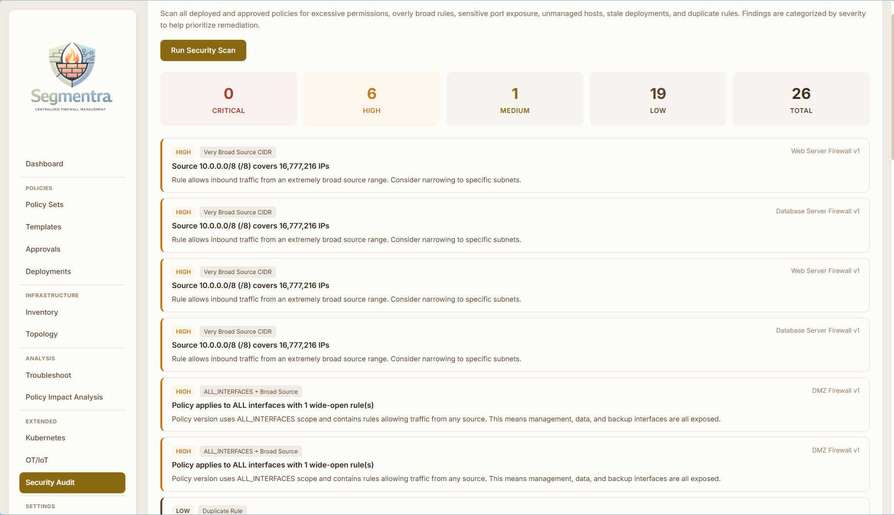
</div>


### Topology 

<div align="center">
  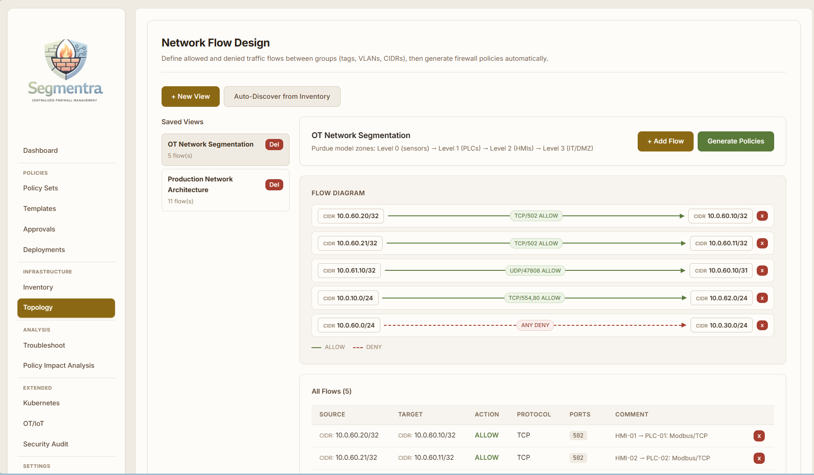
</div>


Still Work in progress :) :) 

### IOT / OT 

<div align="center">
  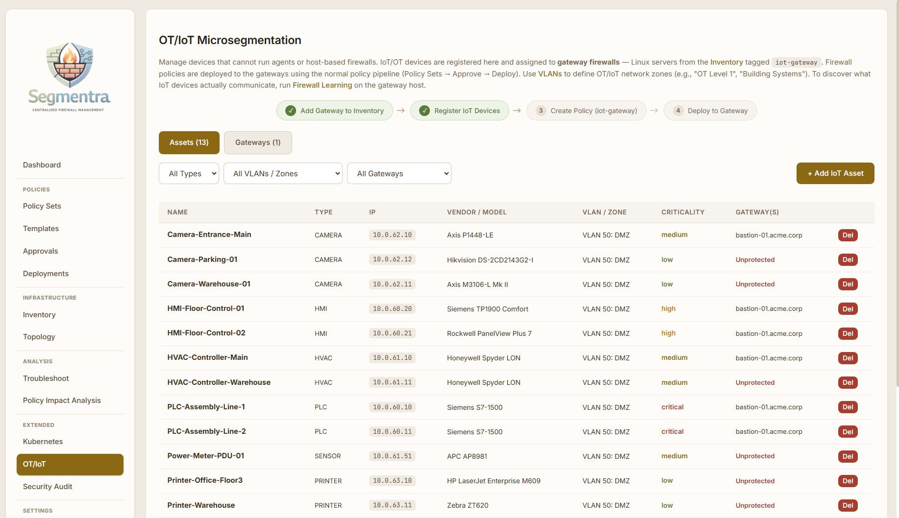
</div>

### Kubernetes 

<div align="center">
  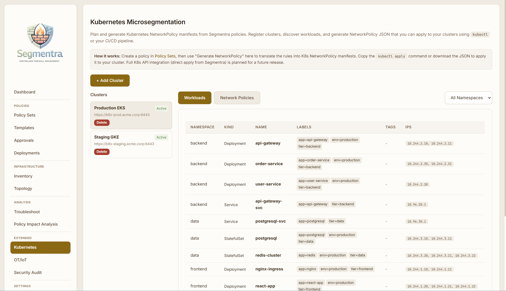
</div>

### Integrations 

<div align="center">
  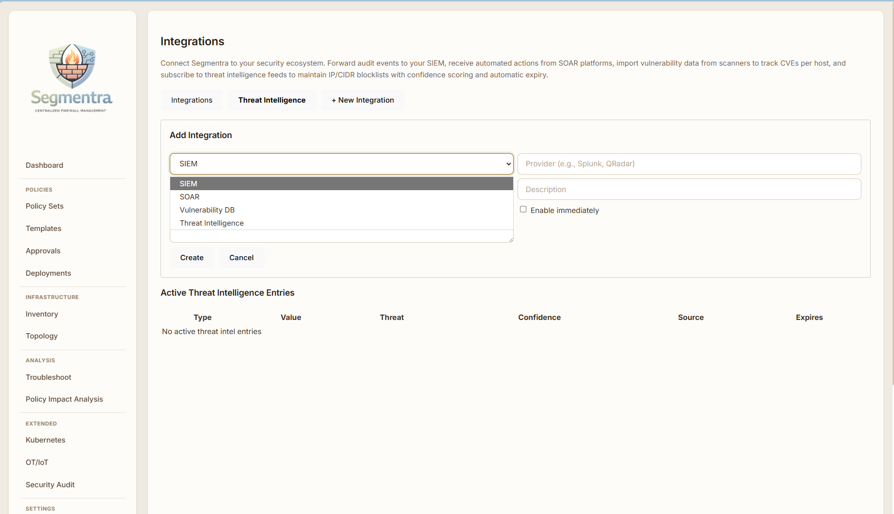
</div>


## User Journey

This is the typical path from an empty installation to enforced firewall rules. Each step names the page in the left-hand menu and the role needed.

### 1. One-time setup (Admin, `admin` role)

- **Deployment executor:** choose **SSH Direct** (lightweight) or **Ansible** (needs the runner container).
- **SSH credentials:** add the account Segmentra uses to reach your hosts, with a private key (optionally passphrase-protected) or a password, and choose how it becomes root: **sudo without password**, **sudo with the login password**, or **sudo with a separate password**. The account needs full sudo rights (it runs `sh` as root); nothing is installed on the hosts. Credentials are stored encrypted. Each credential **applies to** all hosts (global), hosts with a tag, hosts in a VLAN, one host, or no host automatically (*not assigned*, for discovery or explicit assignment). Each host uses its explicitly assigned credential, else a host-, tag-, VLAN- and finally the global credential; the Inventory host list shows which one each host uses.
- **Management VLAN:** pick the VLAN whose subnet may always reach SSH on every host. Without one, SSH is allowed from any source so hosts can't be locked out.
- **Users and roles:** create accounts and give them roles (`viewer`, `operator`, `approver`, `admin`). You need at least two people who can approve, because nobody can approve their own changes (see step 5).

### 2. Inventory: tell Segmentra what you have (`operator` or `admin`)

- **Hosts:** add hosts one by one or with **Bulk Import** (CSV). Each host has a management IP, SSH port and firewall backend (`nftables`, `iptables`, `firewalld`, `ufw` or auto).
- **Check Readiness:** confirms Segmentra can log in over SSH, use `sudo`, and find the firewall tool.
- **Tags and VLANs:** group hosts (e.g. `web`, `db`) and network zones (VLANs with subnets). Rules can target whole groups instead of single IPs.
- **Auto-Tagging:** tag hosts automatically by hostname, IP, OS and so on. Use **Preview Matches** before saving.
- **Discovery:** instead of typing hosts in, create a discovery profile (admin): pick SSH credentials (or add one inline), the networks or VLANs to scan, a schedule (manual or every N minutes/hours) and a tag for new hosts (default `new-server`). **Run Now** (operator/admin) scans for open SSH ports, logs in read-only and imports hosts that are not yet in inventory; hosts that already exist are left untouched. Each run shows per-address results (imported, already present, login failed and why). Credentials added inline in a profile are stored as *not assigned* (unless you make them global), so they never change the credential of other hosts; each imported host is assigned the credential that logged in.
- **Optional:** use **Topology** to draw flows between groups and generate draft policies from them, or **Templates** to start from a reusable rule set.

### 3. Policy Sets: decide where a policy applies (`operator` or `admin`)

A **policy set** is a named policy with a **scope**: the hosts it applies to, chosen by tag, VLAN or an explicit host list. Create one under **Policy Sets → + Create Policy Set**.

### 4. Versions and rules: describe the access (`operator` or `admin`)

- Open the policy set and click **+ New Version** (or **Clone** an existing version to change it). A new version starts as `DRAFT`.
- Add **rules**: direction (in / out / both, or FORWARD on gateways), allow or deny, protocol, ports, and source (CIDR, tag, VLAN or host). Rules are evaluated in order. Anything not allowed inbound is dropped; outbound is allowed by default.
- You never need rules for loopback, established connections or management SSH. Segmentra adds those automatically.
- On IoT/OT gateways (hosts tagged `iot-gateway`), use direction **FORWARD (through gateway)** for traffic routed *through* the gateway. A FORWARD rule has a source and a **destination** (CIDR, tag, VLAN, host or IoT device). Traffic to the IoT devices assigned to that gateway is denied unless a FORWARD rule allows it. Other forwarded traffic is not affected. See [docs/iot.md](docs/iot.md).
- When the version is ready, go back to the policy set and click **Submit for Approval**. The version becomes `PENDING_APPROVAL` and can no longer be edited.

### 5. Approvals: a second person reviews (`approver` or `admin`, but not the author)

- New versions must be approved by a user with the **`approver` or `admin` role who did not create, edit or submit that version**. The app blocks self-approval ("You cannot approve a policy version that you created, edited or submitted").
- When sending a version for approval the author can type a **reason**; the reviewer sees it on the **Approvals** page. **View Rules** opens a dialog with the rules (and an optional **Impact analysis** against an earlier version); **Reject** opens its own dialog and asks for a reason. The author sees the outcome on the Dashboard (**Your approval requests**), in a counter next to Policy Sets, and on the policy set page. Every submission, approval and rejection is written to the audit log with who asked, when, why, who decided and when.
- A rejected version can be fixed and resubmitted. An approved version becomes `APPROVED` and can be deployed.
- **High-risk deployments** (rules that open sensitive or management ports to very broad sources, "any/any"-style rules, or a wide interface scope across many hosts) also need a deployment-level approval by an `approver`/`admin` other than the person who created the deployment.

### 6. Deployments: push the rules to hosts (`operator` or `admin`)

- **Deployments → + Create Deployment:** pick an approved version, the targets and a mode (`FULL`, `CANARY` or `PROGRESSIVE`). You can also schedule it for later and set an expiry date with an action (notify only, remove the rules, or revert to the previous version).
- Click **Start**. Each host is backed up first, the rules are applied, and Segmentra checks that it can still reach the host over SSH. If not, the change is reverted automatically after about two minutes.
- Follow progress on the deployment page. If some hosts fail, use **Retry Failed Hosts** once the problem is fixed. A successful deployment marks the version `DEPLOYED`, and the policy set page shows which version is **active** on how many hosts.
- Only Segmentra's own firewall rules are replaced. Rules from Docker, Kubernetes or fail2ban are left alone.

### 7. Operate: verify, troubleshoot and audit

- **Inventory → Check Compliance:** detects drift when someone changes Segmentra's rules on a host by hand.
- **Troubleshoot:** simulate whether traffic between two IPs would be allowed, search which policies affect an IP or host, or run **Firewall Learning** (log-only mode) to discover real traffic.
- **Policy Impact Analysis:** run a version in log-only mode on a host before enforcing it, then analyze which observed traffic it would allow or block.
- **Security Audit, Audit Log, Notifications and Integrations:** scan for risky rules, review who did what, get alerts (Slack or webhook), and forward the audit log to a SIEM.

Typical lifecycle of a version: `DRAFT` → `PENDING_APPROVAL` → `APPROVED` (or `REJECTED` → fix → resubmit) → `DEPLOYED`; old versions can be `ARCHIVED`.

---

## Installation & Quick Start

### Automated Installation

**Linux/macOS:**
```bash
./install.sh --development    # Local dev environment
./install.sh --production     # Docker production deployment
```

**Windows (PowerShell):**
```powershell
.\install.ps1 --development
.\install.ps1 --production
.\run.ps1 -start -development     # note: run.ps1 uses single-dash switches
```

`--production` generates `JWT_SECRET`, `SEGMENTRA_KEK_B64`, `POSTGRES_PASSWORD` and `SEGMENTRA_ADMIN_PASSWORD` into `.env` (kept if already present) and prints the initial admin password. Back up `.env` — losing `SEGMENTRA_KEK_B64` makes stored SSH/LDAP secrets unrecoverable.

### Running

```bash
./run.sh --start --development    # Start dev (API + UI + DB)
./run.sh --stop --development     # Stop dev
./run.sh --start --production     # Start production (all Docker containers; the API runs migrations on start)
./run.sh --stop --production      # Stop production
```

### Default Login

- **Development**: `admin` / `admin123` (created by the seed when `SEGMENTRA_ADMIN_PASSWORD` is not set — change it after first login)
- **Production** (`NODE_ENV=production`): `admin` / the value of `SEGMENTRA_ADMIN_PASSWORD` (min. 12 chars). Without it the seed refuses to create the default admin; use `SEGMENTRA_BOOTSTRAP_TOKEN` instead if you only use LDAP.

### Docker

Production runs entirely in Docker; the images are built from this repository (no Node.js needed on the host):

```bash
./install.sh --production        # creates .env with generated secrets, builds and starts everything
# or manually, after creating .env:
docker compose up -d --build     # build the images and start db, API, web (nginx) and Ansible runner
```

Then open `http://<host>` (port 80). To upgrade: `git pull && docker compose up -d --build` (migrations run automatically). See [Building the Docker Images](docs/installation.md#building-the-docker-images) and [Upgrading](docs/installation.md#upgrading-to-a-new-version) for what each image contains, rebuilding single images and pushing to a registry.

### Security hardening

Segmentra can change the firewall of every managed host and stores SSH credentials with `sudo` rights on all of them, so a compromised Segmentra means compromised hosts. Before going to production:

- **Use the hardened override:** `docker compose -f docker-compose.yml -f docker-compose.hardened.yml up -d --build`. This removes the Docker socket, makes the containers read-only, drops Linux capabilities, sets resource limits and publishes only nginx. It requires the SSH Direct executor.
- **Network:** serve the UI over TLS (reverse proxy) and make it reachable only from a management network or VPN.
- **Managed hosts:** use a dedicated SSH user with keys, restricted to logins from the Segmentra host, and set a management VLAN.
- **Secrets:** `chmod 600 .env` and back it up separately from database backups.
- **People:** use LDAP with MFA at your identity provider, keep few admins, and monitor the audit log (forward it to your SIEM).

The full guide, including what is already hardened and the remaining gaps, is in [docs/security.md](docs/security.md#hardening-a-production-install).

For detailed installation instructions, see [installation.md](docs/installation.md).

---

## Integration Tests

Segmentra includes a Docker-based integration test for the SSH deployment path. If you want to validate a new local version of the app, you can run the starter script from the repository root:

```bash
npm run test:integration:ssh-docker
```

This builds the current code, starts a temporary API + PostgreSQL + 3 target-container environment, deploys sample firewall ACLs through the real API using both SSH password and SSH key authentication, verifies the resulting `iptables` state, and runs live `ping` checks between the targets. For full details, see [tests/README.md](tests/README.md).

Other integration tests need a running Segmentra API: `npm run test:integration:policy-code` (policy as code: export, import, validation, CLI) and `npm run test:integration:compliance` (compliance reports; the tamper check uses `docker exec` on the database container and is skipped without it), neither of which needs a lab, `npm run test:integration:review-fixes` (troubleshoot's effective policy, the per-host lock and the restore guard) and `npm run test:integration:race` (a real deployment racing a real learning-session restore in Docker) and `npm run test:review-fixes` (unit tests: unresolved interface scopes and drift hooks, no API needed), and, with Docker Desktop or Docker, `npm run test:integration:k8s -- <kindnet|calico|cilium>` (Kubernetes enforcement on kind clusters) and `npm run test:integration:swarm` (a 3-node Docker Swarm lab). They create their own lab and remove it afterwards; run them against a development stack, because they leave users, hosts and archived policy sets behind.

---

## Architecture

TypeScript monorepo:

| Component | Location | Purpose |
|-----------|----------|---------|
| **API** | `apps/api` | Express + PostgreSQL backend |
| **UI** | `apps/web` | React (Vite) frontend |
| **Compiler** | `packages/compiler` | Policy → nftables/iptables rules or native firewalld/UFW artifacts |
| **Executor** | `packages/executor` | SSH Direct + Ansible deployment |
| **DB** | `packages/db` | PostgreSQL migrations + seed scripts |

Production runs 4 Docker containers: `segmentra-web` (nginx, port 80), `segmentra-app` (API, published on 127.0.0.1:8080 only), `segmentra-db` (PostgreSQL, 127.0.0.1:15432 only), `segmentra-ansible-runner` (Ansible executor). With the hardened override (`docker-compose.hardened.yml`) the Ansible runner is not started (only with `--profile ansible`) and only nginx is published.

> **Security note — Docker socket:** `segmentra-app` mounts `/var/run/docker.sock` so the Ansible executor can run `docker exec segmentra-ansible-runner ansible-playbook ...`. Access to the Docker socket is equivalent to root on the Docker host. If you only use the SSH executor, remove that mount (and `group_add`) from `docker-compose.yml`, or use the hardened override, which does this.

For detailed technical documentation, see [Architecture.md](docs/Architecture.md).

---

## Configuration

| Variable | Required | Default | Description |
|----------|----------|---------|-------------|
| `DATABASE_URL` | Yes | — | PostgreSQL connection string |
| `JWT_SECRET` | Yes | — | JWT signing secret. Min. 32 chars when `NODE_ENV=production` (16 in dev); known placeholder values are refused in production |
| `SEGMENTRA_KEK_B64` | Prod: yes | — | 32 random bytes, canonical base64 (`openssl rand -base64 32`): key for AES-256-GCM secret encryption. In development, if unset, the key is **derived from `JWT_SECRET`**, so rotating `JWT_SECRET` makes stored secrets undecryptable. Set it explicitly in production and **before** storing any secrets; changing it later requires re-entering secrets. The API validates it at startup and refuses to start without it in production |
| `NODE_ENV` | No | — | `production` enables strict checks (JWT length, KEK required in Docker, no default admin password) |
| `PORT` | No | `8080` | API server port |
| `BUNDLES_DIR` | No | `./data/bundles` | Deployment bundle directory (`/bundles` in Docker, shared with the Ansible runner) |
| `ANSIBLE_RUNNER_CONTAINER` | No | `segmentra-ansible-runner` | Ansible runner container name used with `docker exec` |
| `CORS_ORIGIN` | No | Same-origin only in production; allow all in development | Comma-separated HTTP(S) browser origins without paths or wildcards; set for cross-origin UI access |
| `TRUST_PROXY` | No | — | Express `trust proxy` value (`1`, `loopback`, CIDR, `true`) when the API is behind a reverse proxy, so client IPs (login rate limiting, audit) are correct. docker-compose sets `1` (nginx) |
| `SEGMENTRA_KNOWN_HOSTS` | No | `~/.ssh/known_hosts` | known_hosts file for SSH executor / readiness / audit connections. Unknown hosts are trusted on first use (`StrictHostKeyChecking=accept-new`); changed host keys are rejected |
| `SEGMENTRA_ALLOW_PRIVATE_WEBHOOKS` | No | `false` | Set `true` to allow notification webhooks to loopback, link-local and cloud-metadata addresses (blocked by default to prevent SSRF; RFC1918 private ranges are always allowed) |
| `SEGMENTRA_BOOTSTRAP_TOKEN` | No | — | Enables the one-time `POST /api/admin/bootstrap` endpoint (only while no users exist); requires `token`, optional `username`, and `password` (12+ characters, at most 72 UTF-8 bytes) |
| `SEGMENTRA_ADMIN_PASSWORD` | Prod: yes | `admin123` in dev | Password for the initial `admin` user created by `npm run db:seed` (min. 12 chars in production) |
| `SEGMENTRA_SSH_COMMAND_TIMEOUT_MS` | No | `300000` | Per-command SSH timeout |
| `SEGMENTRA_ASKPASS_DIR` | No | OS temp dir | Directory for the `SSH_ASKPASS` helper script used for passphrase-protected keys (the script contains no secret) |
| `SEGMENTRA_SKIP_MIGRATIONS` | No | `0` | API Docker image only: `1` skips the migrations and seed the entrypoint runs on start |

docker-compose additionally reads `POSTGRES_PASSWORD` (or legacy `DB_PASSWORD`), `DB_USER`, `DB_NAME`, `DB_PORT`, `API_PORT`, `API_BIND`, `WEB_PORT` and `DOCKER_GID` (group owning `/var/run/docker.sock`). The local launchers (`start.sh`, `run.sh`) also accept `SEGMENTRA_DATABASE_URL` (custom database URL), and `start.sh` accepts `SEGMENTRA_RESET_DB=1` (wipes the Docker volumes first, data loss).

---

## Coexistence with Docker, Kubernetes and fail2ban

Segmentra only manages its own firewall objects and leaves rules created by other tools alone:

- **nftables:** everything lives in `table inet segmentra`, which is replaced atomically on each deploy. Other tables (Docker, Kubernetes, fail2ban) are not touched.
- **iptables / ip6tables:** rules live in the dedicated chains `SEGMENTRA-IN` and `SEGMENTRA-OUT`, applied with `iptables-restore --noflush` and reached from a single jump at the top of `INPUT` / `OUTPUT`. `DOCKER*`, `KUBE-*` and `f2b-*` chains, the `FORWARD` chain (except the one jump described below for gateways) and the built-in chain policies are not modified. The default inbound drop is the last rule of `SEGMENTRA-IN`. Allowed traffic leaves Segmentra's chain with `RETURN` (not `ACCEPT`), so rules after the jump still apply, such as fail2ban bans or your own `DROP`s. This matches nftables, where an accept in `table inet segmentra` doesn't override a drop in another table. If you set the `INPUT` policy to `DROP` yourself, you also need your own accept rules for traffic Segmentra allows.
- **Backend tools:** a host configured for iptables only needs `iptables-restore`, and one configured for nftables only needs `nft`. Having both installed is fine; modern distributions ship `iptables-nft` alongside `nft`.
- **Native firewalld/UFW:** Segmentra writes permanent native policy objects/custom-rule blocks, verifies live rules and boot-service enablement, and includes both live and saved state in drift checks. Native allows are authoritative within the manager; see [native firewall managers](docs/firewall-managers.md) for coexistence, prerequisites, and scope/learning limitations.
- **Upgrading hosts deployed by older versions** (which replaced the whole iptables filter table): the first deploy removes the old Segmentra rules from `INPUT`/`OUTPUT` and resets the `INPUT`/`OUTPUT` policy to `ACCEPT` (only if Segmentra had set it to `DROP`). Rules that can't be positively identified as Segmentra's are left in place and reported as warnings in the deployment output. `FORWARD` is left at `DROP` when Docker or Kubernetes chains are present.

- **Docker published ports (opt-in per host):** with *Apply inbound policy rules to Docker-published ports* the `SEGMENTRA-FWD` chain also filters DNAT-ed traffic, and a second jump from `DOCKER-USER` keeps it ahead of Docker's `DOCKER-INGRESS` after Docker re-orders `FORWARD`. Docker's own chains and rules are not modified. Swarm nodes additionally always allow the cluster ports from their peers. See [Docker Swarm and Docker-published ports](#docker-swarm-and-docker-published-ports).
- **Forwarded traffic (IoT/OT gateways):** forwarding is filtered only on hosts whose policy has FORWARD rules or that protect IoT devices (assets assigned to the host on the OT/IoT page). With nftables this is a `chain forward` inside `table inet segmentra` (policy `accept`). With iptables it is a `SEGMENTRA-FWD` chain reached from a single jump at the top of `FORWARD`. Only traffic *to protected devices* is dropped unless a FORWARD rule allows it. Other forwarded traffic, including Docker's, passes as before. Allowed traffic leaves `SEGMENTRA-FWD` with `RETURN`, so `DOCKER-USER` and other `FORWARD` rules after the jump still apply. Deploying a version without forwarding, or removing the policy, deletes the forward chain and its jump. On other hosts nothing changes.

- **Reboot persistence** uses the distribution's own service and touches only Segmentra's part of its files: one `include` line plus `segmentra.nft` for nftables, only the `SEGMENTRA-*` lines of the saved filter table for iptables, permanent native policy XML for firewalld, or marked before-rule blocks for UFW. Docker and Kubernetes chains are not copied into these files. See [Persistence across reboots](#persistence-across-reboots).

Drift detection only fingerprints Segmentra's own objects. Native-manager hashes cover both permanent configuration and live enforcement; unrelated administrator rules and counters are excluded.

### Persistence across reboots

Deployments load the rules into the running kernel. To make them survive a reboot, Segmentra writes them into the files the **distribution's own firewall service** loads at boot. Segmentra stays agentless: no Segmentra service, timer, cron job or script runs at boot.

For **firewalld**, permanent policies are stored in `/etc/firewalld/policies/segmentra-{in,out,fwd}.xml` (`fwd` only when needed) and loaded by `firewalld.service`. For **UFW**, marked blocks are stored in `/etc/ufw/before.rules` and `/etc/ufw/before6.rules`, loaded by enabled UFW and `ufw.service`. Both require Python 3, systemd, and an already active manager. Deployment verifies live enforcement, permanent state, and boot-service enablement; persistence failure triggers rollback. Native reloads are required, and firewalld operations refuse unrelated unsaved runtime changes. See [native firewall managers](docs/firewall-managers.md).

The following table and service behavior apply to the **raw nftables/iptables backends**, not native firewalld/UFW:

| | Debian, Ubuntu | RHEL, Rocky, AlmaLinux (Fedora, CentOS Stream) |
|---|---|---|
| **nftables** | `/etc/nftables.d/segmentra.nft` + one `include` line at the end of `/etc/nftables.conf`; `nftables.service` enabled | `/etc/nftables/segmentra.nft` + one `include` line at the end of `/etc/sysconfig/nftables.conf`; `nftables.service` enabled |
| **iptables** | Segmentra's chains and jumps merged into `/etc/iptables/rules.v4` / `rules.v6`; needs `iptables-persistent` (`netfilter-persistent.service` enabled) | merged into `/etc/sysconfig/iptables` / `ip6tables`; needs `iptables-services` (`iptables` / `ip6tables.service` enabled) |

- **What is written:** the nft file holds `table inet segmentra` behind `add table` + `delete table`, so it is safe to load at boot. The include line is added once, below a `# managed by Segmentra` marker; the rest of `nftables.conf` is not changed (if the file is missing it is created without `flush ruleset`). For iptables only Segmentra's lines are replaced; every other line of the saved file stays byte-identical. A missing rules file is created with only Segmentra's chains (and only if the package is installed). The previous version of each file is kept in `/var/backups/segmentra/persist/`.
- **Services are only enabled, never started or restarted** (a restart would reload the whole saved configuration and, with `flush ruleset`, remove Docker's rules at runtime). Debian/Ubuntu's stock `nftables.conf` starts with `flush ruleset`; at boot that runs before Docker or Kubernetes start, so it is harmless, and it is reported as a note.
- **Never done:** installing packages or disabling firewalld. What is missing is reported per host as a warning in the deployment ("Survives reboot" column: ✓ or ⚠ with the reason) and in the readiness check: `firewalld_active`, `iptables_persistent_missing`, `iptables_services_missing`, `no_nftables_service`, `unsupported_distro`.
- **Always the final, enforced state:** SSH Direct persists only after the reachability check passed and the lockout auto-revert was cancelled. The auto-revert, the rollback after a failed apply, Firewall Learning / policy-test restores and `scripts/restore-previous-policy.sh` re-sync the boot configuration to the restored state. A log-only Firewall Learning or policy-test policy is never persisted: a reboot during a session brings back the last enforced policy. Removing the policy (expiry REMOVE) removes Segmentra's include line, file and merged lines; the distribution service stays enabled. The Ansible executor runs the same steps.
- **Drift:** the compliance check also reports whether the boot configuration matches the running Segmentra rules (`persistence.state`: `in_sync`, `differs`, `missing`).

## Known Limitations

- **Restores on legacy iptables hosts.** Backups and restores (lockout auto-revert, failure rollback, firewall-learning / policy-test restores, `scripts/restore-previous-policy.sh`) only cover Segmentra's own `table inet segmentra` or `SEGMENTRA-IN` / `SEGMENTRA-OUT` chains, so other tools' rules are never replaced. The exception is a host still running a policy deployed by an older version that replaced the whole iptables filter table: restoring that backup replaces the `filter` table, so filter rules other tools added after the backup are lost. Redeploying once moves the host to the chain-based design.
- **SSH credential scope.** Credentials apply to all hosts, a tag, a VLAN or a single host, or are assigned to hosts explicitly; there is no per-environment scope or credential set with automatic fallback (if the chosen credential fails, Segmentra does not try the next one). Tag/VLAN/host scopes have no foreign key: deleting the tag, VLAN or host leaves the credential in place, matching nothing. Hosts imported by discovery before credential scoping kept their host-scoped copies named `… (discovered: <host>)`; they still work and can be deleted once the host is assigned a credential.
- **Per-host serialization.** Deployments, firewall-learning sessions and policy-test sessions take a per-host lock (a PostgreSQL advisory lock), and a session that ends after a deployment succeeded on the same host does **not** restore its older backup over it (the session records `restoreSkipped`). Not covered by the lock: the expiry actions that remove rules (`REMOVE`), manual `scripts/restore-previous-policy.sh`, and changes made on the host outside Segmentra. The lock is held for the duration of the SSH or Ansible run, so a second operation on the same host waits; there is no timeout.
- **Interface scopes.** New policy versions and templates default to **All interfaces** (earlier they defaulted to the role `data`, which silently meant "all interfaces" on hosts without recorded interfaces). Existing versions that still use a role scope fail on such hosts with a clear message until a new version is created. A rule or policy scoped to an interface role or name that matches no enabled interface on a host makes compiling for that host fail (it never widens to all interfaces), so such a host must have its interfaces recorded before deploying.
- **Drift baselines from older versions.** Hosts last deployed before drift fingerprints were scoped to Segmentra's own rules show compliance status `unknown` until they are redeployed once.
- **Policy expiry actions.** If a REMOVE or REVERT action fails, the error is recorded and a notification is sent, but it is not retried automatically. REVERT redeploys the previous version only to hosts that actually ran it; other hosts keep the expired policy and are listed in the notification.
- **sudo on target hosts.** Segmentra is agentless and runs every root step as `sudo sh -c '…'`, so the account needs **full sudo rights** (`ALL`): a sudoers rule limited to `nft` / `iptables` is not enough. sudo may ask for a password (the login password or a separate sudo password, set per credential), or be passwordless. Not supported: sudoers with `Defaults requiretty` for the account (readiness checks and deployments report it with a clear error; disable it for that account), privilege escalation other than sudo (`su`, `doas`, `pbrun`), and sudo configured to ask for the root or target user's password via `rootpw` / `targetpw` unless you enter that password as the separate sudo password.
- **SIEM forwarding.** Notification webhooks connect only to the exact address that was validated, so DNS rebinding doesn't work against them. Syslog/SIEM destinations configured by admins don't get the same connect-time address check.
- **Sessions after a password change.** Changing or resetting a password does not end existing sessions: JWTs stay valid until they expire (up to 12 hours). Deactivating the user blocks them immediately (roles are also re-read on every request), but reactivating the account within those 12 hours makes its unexpired tokens valid again.
- **Raw-backend persistence with firewalld.** Raw nftables/iptables persistence still conflicts with active/enabled firewalld and reports `firewalld_active`. Use the supported native `firewalld` backend to persist ACLs through firewalld itself; remove any old raw Segmentra policy before switching.
- **Native-manager limits.** Firewalld requires its native policy API, nftables backend, and `ALL_INTERFACES` for non-forward rules. UFW requires IPv6 enabled and both family save/restore tools. Learning/log-only sessions are rejected without changing the ACL. Native prerequisites and persistence checks fail deployment instead of silently applying runtime-only rules.
- **Raw-backend persistence on other distributions.** Distribution-specific raw persistence supports Debian, Ubuntu and RHEL-family hosts. Other distributions report `unsupported_distro`. Native firewalld/UFW persistence instead depends on the manager/service prerequisites; this is not certification of every distribution. Missing packages are reported, never installed. Saved administrator catch-all REJECT/DROP rules can still block raw-backend allows after reboot.
- **Docker Swarm and published ports.** Peers are derived from the inventory (redeploy the other nodes after adding or removing a node), published-port enforcement denies every published port no rule allows (also ports published later) and every other DNAT traffic from outside Docker's bridges, and it needs the iptables or nftables backend. Details and the not-tested list are in [Docker Swarm and Docker-published ports](#docker-swarm-and-docker-published-ports).
- **Docker socket.** The Ansible executor runs `docker exec` and therefore needs `/var/run/docker.sock`, which is root-equivalent on the Docker host. SSH-executor-only installations can remove the mount.
- **Ansible executor:**
  - It needs **Python on the target hosts** (readiness warns if it's missing).
  - It deploys all hosts in one run: canary and progressive modes have no effect.
  - Raw nftables/iptables deployments have no lockout auto-revert. Native firewalld/UFW deployments schedule a systemd rollback, reconnect over SSH, and require persistence verification before cancelling it.
  - The native-manager Ansible path is syntax-checked but still needs end-to-end testing on systemd targets. SSH Direct native deployment was tested live.
- **`scripts/restore-previous-policy.sh`** needs SSH key or agent login and passwordless sudo on the hosts (it reports clearly when sudo asks for a password).

---

## Not Yet Tested

### What has been tested

Everything below was exercised against Docker containers. The core workflow went through the web UI; the rest went through the same REST calls the UI makes.

- **Inventory and policy workflow end to end in Chrome, on two real Docker Linux servers (Alpine, SSH key login):** an SSH key credential; a Discovery profile that found both servers (hostname, OS, backend and sudo read from the hosts) and imported them with a tag; an Auto-Tagging rule with preview; a tag-scoped policy set with two rules; submit, then approval by a second user; a Canary deployment; the real `iptables` chains on both servers; live traffic (port 80 reachable, 8080 blocked, ping answered); Check Compliance (Compliant, then Drifted after a rule was deleted by hand on one server); Check Readiness; and View Visualization. This run found and fixed three problems (the default interface scope, ICMP rules missing from the visualization, and an overlapping label). A second pass covered the approval chain through two users: a reason on submit, View Rules and Reject dialogs, a rejection and what the author sees (Dashboard card, menu counter, policy set page), a new version, approval, a deployment that replaced the old rules on both servers (checked with `iptables` and live traffic), Check Compliance, Check Readiness, View Visualization, the Created-by filter on Deployments, a YAML export, an import with validation errors and then a valid import, and the Audit Log entries; that pass found one more bug (the web client dropped the new Created-by filter). Two prompts in the UI (Start deployment, Delete user) use the browser's native confirm box, which the browser tool used here cannot click, so those were accepted by script.
- **Core workflow (web UI), on Alpine containers with iptables and nftables:** inventory, policy sets and versions, approvals, deployments, drift, expiry REMOVE and REVERT, simulator, topology, templates, OT/IoT, security audit, SIEM syslog, webhooks and role-based access. The automated Docker SSH integration test also passes.
- **Real distributions:** Debian 12, Ubuntu 24.04 and Rocky Linux 9.3, each running its stock packages and PAM-based sudo with a password:
  - discovery, readiness, nftables and iptables deployments, drift and expiry REMOVE;
  - **reboot persistence** through each OS's own service. In the raw-backend systemd-container tests the rules came back, saved admin rules stayed byte-identical, and removal cleaned up. Raw deployments on Rocky with firewalld running correctly report their persistence conflict; this does not describe the new native firewalld backend.
- **Native firewalld and UFW, Ubuntu 24.04 containers on Docker Desktop (2026-10-09):** production SSH readiness/auto-detection, deployment, readback, removal, IPv4/IPv6 allowed/blocked TCP traffic, native reload, restart persistence, live drift, scoped rollback, and administrator-rule preservation passed. Unsupported learning attempts left the enforced ACL unchanged. The containers use a test-only systemctl wrapper and the actual native managers; no Segmentra code reapplies rules at startup. This is not a full systemd VM/server reboot test. Reproduce with `npm run test:integration:firewall-managers`; add `-- --keep` to retain containers and inspect their PASS logs.
- **Credentials:**
  - private keys (ed25519, and RSA in PEM format) with and without a passphrase, and password login;
  - sudo with no password, with the login password, or with a separate password;
  - a wrong sudo password and `requiretty` (both give a clear error);
  - credential scoping: global, tag, VLAN, host, not assigned, and explicit host assignment, including the Admin and Inventory UI.
- **Executors:**
  - SSH Direct, including lockout auto-revert through both `nohup` and `systemd-run` (Debian with systemd);
  - Ansible end to end through the API with all three credential types, including rescue rollback, FORWARD/IPv6 rules, per-host results from the play recap, lockout detection and an unresponsive host.
- **Rollout modes:** canary and progressive with 6–8 hosts, plus pause, resume and stop.
- **Approvals:** high-risk deployment approval, including the creator not being allowed to approve.
- **Firewall Learning and Policy Impact Analysis with real captured traffic** on Debian 12 (rsyslog, kernel logging enabled for the test): flows, recommendations and impact-analysis coverage.
- **IoT gateways:**
  - FORWARD rules on nftables and iptables, including IPv6 devices and rules;
  - two gateways protecting one device;
  - expiry REVERT on a gateway, and unassigning a device;
  - the Ansible executor with FORWARD rules.
- **Discovery:**
  - a /24, and a /20 (4,094 addresses in about 100 s);
  - hosts that drop or reject SSH probes are counted as closed without hanging;
  - scheduled runs, and credentials that need a sudo password.
- **Auto-tagging and template auto-apply:**
  - all condition fields, including `environment`, with AND/OR;
  - disable, retarget and delete, and priority between rules;
  - the 5-minute job adding and removing tags;
  - auto-apply creating a DRAFT policy.
- **LDAP** against OpenLDAP:
  - group-to-role mapping, both via memberOf and via a group-filter lookup;
  - injection attempts;
  - disabled LDAP, and deactivated users.
- **Notifications:**
  - webhook delivery, and Slack against a mock webhook;
  - event subscriptions;
  - SSRF checks.
- **Threat intelligence:** AbuseIPDB against a mock of its API (error handling, auto-block drafts, deduplication).
- **SIEM forwarding:** every audit event forwarded exactly once (including a second API replica and a reconnect), with no secrets in messages. Integration and notification secrets are encrypted at rest; a database dump showed none of them.
- **Compliance reports:** `npm run test:integration:compliance` runs 35 checks against the real API (see [Compliance Evidence Reports](#compliance-evidence-reports)).
- **Policy as code:** `npm run test:integration:policy-code` runs 48 checks against the real API and the CLI: dry run writes nothing, create, idempotency (YAML text, JSON, `{content}`), deterministic export and export-import round trip (including FORWARD rules and interface scopes), diff on change and reordering detection, the approval workflow and separation of duties on imported drafts, all validation problems reported together with their paths (typos, unknown tags, duplicate order, bad CIDR and ports, FORWARD without destination), scope protection (`updateScope`), permissions (viewer and approver cannot import), ambiguous names, and the CLI's `plan`/`apply` exit codes.
- **Docker Swarm:** `npm run test:integration:swarm` builds a 3-node Swarm on Docker Desktop (privileged Docker-in-Docker nodes with sshd, an overlay network, a published nginx service and two client containers) and runs 35 checks through the real API and SSH executor: the allowed client reaches the published port on every node and a client the policy does not allow is blocked on every node, the overlay stays healthy without the policy mentioning any Swarm port, a port published later is blocked without a redeployment even after Docker re-ordered its `FORWARD` jumps, redeploying is idempotent, remove, backup and restore handle the `DOCKER-USER` jump and leave Docker's chain alone, the saved-rules rendering merges with existing fail2ban/Docker lines, and each feature makes a difference when switched off. `npm run test:swarm-compile` unit-tests the generated rules for both backends.
- **Kubernetes:** `npm run test:integration:k8s` builds 3-node kind clusters with **kindnet**, **Calico** and **Cilium** and runs 69 checks on each against the real API: stored kubeconfig and service-account token credentials, apply, dry run, drift check and removal through Segmentra, real pod-to-pod TCP/UDP enforcement (CIDR, HOST, TAG, VLAN, `any`, port ranges, same-node and cross-node clients, selector peers, updates), refusal to overwrite or delete a policy Segmentra did not create, read-only RBAC failure, and no credential material in any API response. The cloud-login token minting has unit tests (`npm run test:k8s-auth`: SigV4 against AWS's documented example, JWT signature, mocked token endpoints). Earlier generated manifests were also applied to k3s v1.30 and enforced.
- **Other:** `scripts/restore-previous-policy.sh` (`--latest` / `--timestamp`); password change and reset; and the PowerShell scripts parse under PowerShell 7 and as Windows PowerShell 5.1 would read them.

### Not yet tested or not implemented

- **Email notifications are not implemented.** There is no SMTP sending; email channels report FAILED.
- **Kubernetes: see [Not tested yet / Not supported yet](#kubernetes-not-tested-yet).** Workload discovery is not implemented (the sync endpoint returns `501`), only kind clusters were tested (the EKS/GKE/AKS cloud logins never against real clouds), and generated manifests use `podSelector: {}` (all pods in the namespace).
- **Docker Swarm: see [Not tested yet / Not supported yet](#docker-swarm-and-docker-published-ports).** Only a Docker Desktop lab was used (one kernel, Docker 27.5, `iptables-nft`): real multi-machine swarms, reboots, Docker daemon restarts and upgrades, the nftables backend on a live Docker host, Docker 28+, encrypted overlays, host-mode and IPv6 published ports are untested.
- **Microsoft Active Directory itself, and LDAPS with a real certificate.** Only OpenLDAP was tested.
- **The real AbuseIPDB service**, as opposed to the mock, and real Slack workspaces.
- **Hosts that log only to journald (no rsyslog).** Firewall Learning reads the rsyslog file, so such hosts capture no flows. FORWARD traffic on gateways is not analyzed by Learning or Policy Impact Analysis, by design.
- **Native-manager full systemd VM/server reboots, native Ansible end-to-end, and native gateway forwarding traffic.** Host TCP enforcement and container restarts were tested; native gateway compilation has regression coverage.
- **RHEL with SELinux enforcing and native firewalld**, and SUSE, Arch, older releases and Alpine. The raw-backend persistence path reports `unsupported_distro` outside Debian/Ubuntu/RHEL families; native managers have their own prerequisites.
- **ECDSA and PKCS#8-encrypted keys** on a live host (they pass validation), and OpenSSH clients older than 8.4.
- **The Windows scripts were not run on Windows.** `start.bat` was only reviewed.
- **Real OT protocols** beyond a TCP test listener on gateways.
- **A full deployment through a browser with the Ansible executor.** Ansible was tested through the API.

See also [Known Limitations](#known-limitations) and the [OT/IoT guide](docs/iot.md#9-limitations-and-what-is-not-tested).

---

## Future Work

### Features not implemented yet

- **Email notifications.** Email channels can be configured but there is no SMTP sending yet; they report FAILED with "Email delivery is not implemented yet". Plan: add an SMTP client (e.g. nodemailer) with TLS, authentication stored encrypted like other secrets, and a test-send button.
- **Kubernetes workload discovery.** The sync endpoint returns `501 not_implemented`. Workloads are registered by hand; with the stored cluster credentials Segmentra could now read namespaces, workloads and pod labels from the cluster and map labels to tags automatically. Generated NetworkPolicies still select all pods in the namespace (`podSelector: {}`).
- **Compliance report follow-ups.** Scheduled generation and delivery, reports scoped by tag or VLAN (for example only the cardholder-data environment), more frameworks, signed PDF output, and continuous firewall-log evidence (see [Compliance Reports](docs/compliance-reports.md#not-supported-yet)).
- **Policy as code follow-ups.** Segmentra pulling from Git itself, hosts/tags/VLANs/templates as code, a published JSON Schema, and atomic multi-document imports (see [Policy as Code](docs/policy-as-code.md#not-supported-yet)).
- **Docker Swarm awareness.** Read services, stacks and published ports from the Docker API so policies can refer to services, warn when a swarm node is missing from the inventory, and cover container-to-container and overlay traffic.
- **UI for API-only features.** These work through the API but have no screens yet: policy recommendations, enforcement points (network device ACLs), IoT baselines and observed flows, host interfaces, and the per-host compiled-policy preview (`render`).
- **More integrations.** SOAR and vulnerability-database integrations can be configured but don't do anything yet.

### Testing still to do

- **Microsoft Active Directory** (only OpenLDAP was tested), and LDAPS with a real certificate.
- **The real AbuseIPDB service and real Slack workspaces.** Both were tested against mocks.
- **Hosts that log only to journald** (no rsyslog) for Firewall Learning and Policy Impact Analysis.
- **Full systemd VM/server reboot validation for native firewalld/UFW**, native Ansible end-to-end, and RHEL with SELinux enforcing and native firewalld. Native ACL persistence is implemented; these target environments still require validation.
- **ECDSA and PKCS#8-encrypted SSH keys** on live hosts, and OpenSSH clients older than 8.4.
- **Running the Windows scripts on Windows** (`start.bat`, `run.ps1`, `install.ps1`, `scripts/check-db-status.ps1`). They were only parsed and reviewed.

---

## Documentation

| Document | Description |
|----------|-------------|
| [Installation Guide](docs/installation.md) | Dev and production setup |
| [Architecture](docs/Architecture.md) | API endpoints, database schema, RBAC matrix |
| [User Guide](docs/guide.md) | Step-by-step usage for all features |
| [Native Firewall Managers](docs/firewall-managers.md) | Firewalld/UFW support, permanent ACLs, prerequisites, limitations, and verification |
| [Security: Credentials, Secrets and Hardening](docs/security.md) | How credentials are encrypted, the encryption key, who can access them, and how to harden a production install |
| [OT/IoT Guide](docs/iot.md) | IoT microsegmentation with gateway model |
| [Gateway Setup](docs/gateway-setup-guide.md) | Linux gateway firewall configuration |
| [Kubernetes Guide](docs/kubernetes.md) | K8s NetworkPolicy management |
| [Docker Swarm Guide](docs/docker-swarm.md) | Swarm node profile and Docker-published ports |
| [Policy as Code](docs/policy-as-code.md) | YAML/JSON export and import, CLI and CI workflow |
| [Compliance Reports](docs/compliance-reports.md) | Evidence reports mapped to PCI DSS, ISO 27001, SOC 2 and HIPAA |
| [Ansible Playbook](docs/playbook-ansible.md) | Deployment playbook documentation |
| [Original Specification](docs/segmentra_fleet_microsegmentation_firewall_manager_full_specification.md) | The original product specification (historical; the implementation differs in places) |

---

## License

Segmentra is licensed under the [Apache License 2.0](LICENSE). Copyright 2026 Belsis Meletis (see [NOTICE](NOTICE)). To report a vulnerability, see [SECURITY.md](SECURITY.md).

### Disclaimer: provided "as is", no liability

**Segmentra is provided "AS IS", without warranty of any kind**, express or implied, including merchantability, fitness for a particular purpose, security, reliability and non-infringement.

**The creator and contributors accept no liability, to the maximum extent permitted by law,** for any damage, loss or claim of any kind arising from the use of, or inability to use, this software, whether in contract, tort or otherwise. This includes, without limitation:

- data loss or corruption;
- downtime, outages or loss of access to systems (including being locked out of hosts);
- security incidents, breaches or vulnerabilities, in Segmentra or in the systems it manages;
- misconfigured, missing or ineffective firewall rules, and traffic that is blocked or allowed by mistake;
- financial, business, legal or regulatory loss, including failed audits (compliance reports are supporting evidence, not an audit opinion or a certification).

Segmentra changes firewall rules on real hosts, clusters and gateways, and is a **work in progress** that has been tested mainly in lab environments (see [Not Yet Tested](#not-yet-tested)). **You use it entirely at your own risk and responsibility.** Test it on non-critical systems first, keep out-of-band access, keep backups, and review every policy before deploying it.

Nothing in this README, the documentation or the user interface changes the terms of the [LICENSE](LICENSE), sections 7 (Disclaimer of Warranty) and 8 (Limitation of Liability).
